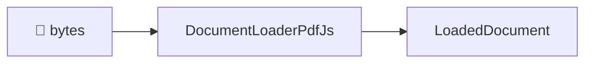

# @docture/docs

The documentation site. [Fumadocs](https://fumadocs.dev) 16 on Next.js 16.

```sh
pnpm docs                      # from the repo root → http://localhost:3100
pnpm --filter @docture/docs build
pnpm --filter @docture/docs typecheck
```

## Brand assets

The approved brand kit in `../../brand/` owns the logo geometry, colors, icons,
and social image. `components/brand-logo.tsx` displays the original outlined SVGs
in shared navigation and the footer. The site's existing `.dark` class selects
the matching artwork without client-side theme state.

Synchronize the deployed subset after updating the brand kit:

```sh
pnpm --filter @docture/docs brand:sync
pnpm --filter @docture/docs check:brand
```

Run these commands from the repository root. `check:docs` also checks that the
deployed assets match their canonical sources. The sync script copies only the
assets used by the site, including `app/brand.css`, `lib/brand.json`, the public
logo and app icons, and Next's favicon, Apple icon, and Open Graph image files.
It derives `app/manifest.webmanifest` from the kit template with public icon paths
and `display: browser` for this documentation site.

Next generates the favicon, manifest, and social-image metadata from those files.
Twitter uses the same Open Graph image. Page titles and descriptions continue to
come from each page. The existing Geist and Geist Mono font loaders retain the
full weight range used by the interface; the logo itself requires no font.

Set `SITE_URL` to the site's absolute deployed origin when building outside
Vercel, for example through the hosting platform's environment settings. The root
layout validates it with `new URL` and uses it as `metadataBase`. Vercel can use
Next's native deployment-origin fallback. Without either setting, Next falls
back to localhost for absolute social-image URLs. No production domain is assumed
by this repository. The package-level `turbo.json` passes the origin settings to
Next and includes them in the build cache key. Changes to the canonical kit and
deployed public assets also invalidate their relevant checks.

## Navigation and page width

Home and documentation use `components/site-header.tsx` through Fumadocs header
slots. `components/docs-header.tsx` supplies the notebook's mobile sidebar trigger.
The primary links come from `primaryNavigation` in `lib/shared.ts`.

Use `site-container` for outer page sections. Its 80rem maximum width and responsive
gutters live in `app/global.css`; the notebook grid uses the same width token.
Keep article, sidebar, and table-of-contents widths inside that shared outer frame.
The header uses inline-size containment so its controls do not change the notebook
grid's minimum column sizes.
Scrollbar space stays reserved so short and long pages retain the same alignment.

## Layout

```
content/docs/          the pages, one .mdx file each, meta.json for ordering
  concepts/            loaders · rasterizers · strategies · classification · schemas
  guides/              task-shaped: with/without a model, scans, long docs, custom loader, accuracy
  reference/           packages · errors · architecture
components/mdx.tsx     MDX component map, where Mermaid is registered
components/mdx/        the Mermaid renderer
lib/source.ts          the content source
source.config.ts       global MDX options (see below)
```

## Writing a diagram

A fenced `mermaid` block. Nothing to import:

````md

````

Add `accTitle` and `accDescr` to name the diagram and describe its flow for screen
readers. Keep the labels concise and explain branches in the surrounding prose.

`remarkMdxMermaid` rewrites the fence into `<Mermaid chart="…" />`.
[`components/mdx/mermaid.tsx`](components/mdx/mermaid.tsx) loads Mermaid on the client
and renders again when the theme changes. Zoom and Expand reuse the rendered SVG.

Diagrams start at 100% with 16px labels. Scroll within the diagram to read a long
flow, or focus its scroll area and use the arrow keys. The toolbar provides zoom
from 25% to 300%, **Reset 100%**, and **Fit** for an overview. Fit can shrink below
25% to show the whole diagram. **Expand** opens a larger reader with the same zoom
and reading position. **Close** or Escape returns to the inline diagram.

## One thing that will bite you

Put extra remark plugins in **`source.config.ts`**, never in `mdxOptions` on the
collection in `lib/source.ts`.

The collection-level option takes raw `ProcessorOptions` and, as its own type documents,
*"the default options & plugins will be removed"*. That silently drops `remarkGfm`, and
every table on the site renders as literal `|` characters, with no error anywhere.

The global config goes through Fumadocs' preset instead, so `remarkGfm`, `remarkHeading`,
`remarkImage` and `remarkStructure` (which feeds search) all survive, and the function
form appends to them:

```ts
// source.config.ts
export default defineConfig({
  mdxOptions: {
    remarkPlugins: (plugins) => [...plugins, remarkMdxMermaid],
  },
});
```

## Conventions

- **Lead with the diagram** where a flow, a decision or a layering is involved. Prose
  explains the diagram; it does not repeat it.
- **Every page opens with what the reader wants**, not with terminology.
- **Say why, not just what.** The design decisions here are the interesting part; a
  reader who understands the reason can predict the behaviour.
- **Do not document what does not exist.** Planned loaders are marked as planned.

## Note on `AGENTS.md` / `CLAUDE.md`

Both are generated by `next dev` and re-created if deleted. Committing them keeps the
tree clean.

## Check imports, coverage, and recipes

`api-reference.ts` assigns every public symbol to a reference page for both published
packages and all 23 public entries. `check:docs` compares the inventory with each package's
`exports` map and actual TypeScript exports. It also checks every pre-migration docs route,
internal links, example references, and prose rules. Named Docture imports in MDX,
TypeScript examples, homepage snippets, and the three public READMEs must match the
inventory.

```sh
pnpm --filter @docture/docs check:docs
pnpm --filter @docture/docs check:examples
```

`typecheck` checks every TypeScript example and runs both commands. `check:examples`
generates invoice PDFs in a temporary directory and executes five offline recipes:
custom components, data sources, deterministic invoice extraction, accuracy scoring, and
document conversion. It checks their output and removes its temporary files.

Model-backed examples compile as part of `typecheck`; executing them needs provider
credentials. Keep the [installation recipes](content/docs/guides/installation.mdx) and
[migration guide](content/docs/guides/migration.mdx) consistent with the package manifests.
