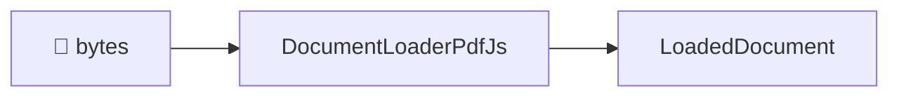

# @docture/docs

The documentation site. [Fumadocs](https://fumadocs.dev) 16 on Next.js 16.

```sh
pnpm docs                      # from the repo root → http://localhost:3100
pnpm --filter @docture/docs build
pnpm --filter @docture/docs typecheck
```

## Layout

```
content/docs/          the pages, one .mdx file each, meta.json for ordering
  concepts/            loaders · rasterizers · strategies · classification · schemas
  guides/              task-shaped: with/without a model, scans, long docs, custom loader, accuracy
  reference/           packages · errors · architecture
components/mdx.tsx     MDX component map, where Mermaid is registered
components/mdx/        the Mermaid renderer
lib/source.ts          the content source
source.config.ts       global MDX options (see below)
```

## Writing a diagram

A fenced `mermaid` block. Nothing to import:

````md

````

`remarkMdxMermaid` rewrites the fence into `<Mermaid chart="…" />`, and
[`components/mdx/mermaid.tsx`](components/mdx/mermaid.tsx) renders it client-side,
lazily, since mermaid is ~1 MB, and re-rendered on a light/dark switch.

## One thing that will bite you

Put extra remark plugins in **`source.config.ts`**, never in `mdxOptions` on the
collection in `lib/source.ts`.

The collection-level option takes raw `ProcessorOptions` and, as its own type documents,
*"the default options & plugins will be removed"*. That silently drops `remarkGfm`, and
every table on the site renders as literal `|` characters, with no error anywhere.

The global config goes through Fumadocs' preset instead, so `remarkGfm`, `remarkHeading`,
`remarkImage` and `remarkStructure` (which feeds search) all survive, and the function
form appends to them:

```ts
// source.config.ts
export default defineConfig({
  mdxOptions: {
    remarkPlugins: (plugins) => [...plugins, remarkMdxMermaid],
  },
});
```

## Conventions

- **Lead with the diagram** where a flow, a decision or a layering is involved. Prose
  explains the diagram; it does not repeat it.
- **Every page opens with what the reader wants**, not with terminology.
- **Say why, not just what.** The design decisions here are the interesting part; a
  reader who understands the reason can predict the behaviour.
- **Do not document what does not exist.** Planned loaders are marked as planned.

## Note on `AGENTS.md` / `CLAUDE.md`

Both are generated by `next dev` and re-created if deleted. Committing them keeps the
tree clean.

## Check imports, coverage, and recipes

`api-reference.ts` assigns every public symbol to a reference page for both published
packages and all 23 public entries. `check:docs` compares the inventory with each package's
`exports` map and actual TypeScript exports. It also checks every pre-migration docs route,
internal links, example references, and prose rules. Named Docture imports in MDX,
TypeScript examples, homepage snippets, and the three public READMEs must match the
inventory.

```sh
pnpm --filter @docture/docs check:docs
pnpm --filter @docture/docs check:examples
```

`typecheck` checks every TypeScript example and runs both commands. `check:examples`
generates invoice PDFs in a temporary directory and executes five offline recipes:
custom components, data sources, deterministic invoice extraction, accuracy scoring, and
document conversion. It checks their output and removes its temporary files.

Model-backed examples compile as part of `typecheck`; executing them needs provider
credentials. Keep the [installation recipes](content/docs/guides/installation.mdx) and
[migration guide](content/docs/guides/migration.mdx) consistent with the package manifests.
