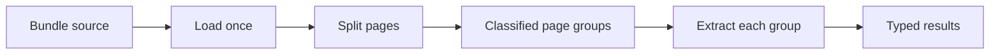

A bundle is one source containing several documents. `Process` loads the source once,
uses a splitter to assign page groups, and extracts each group with its matching
classification.



## Splitter contract

A splitter answers whether two adjacent pages belong to the same document. It also
reports the classification of each page and may report confidence.

```ts
import { defineSplitter } from "docture";

const splitter = defineSplitter({
  name: "invoice-heading",
  requires: ["TEXT_LAYER"],
  async belongsToSameDocument(first, second) {
    return {
      belongsToSameDocument: !/^INVOICE/m.test(second.text),
      classificationPage1: "invoice",
      classificationPage2: "invoice",
    };
  },
});
```

Core folds the pairwise verdicts into ordered `DocGroup` values. Page numbers are
1-based and refer to the original source.

## Eager and lazy splitting

`SplittingStrategy.EAGER` lets a splitter inspect every page in one call through
`splitEager()`. When that method is absent, core uses the lazy path.

`SplittingStrategy.LAZY` checks adjacent page pairs with bounded concurrency. It is a
better fit when the full bundle cannot be sent in one request.

A one-page source is one group and does not call the splitter. With one candidate kind,
`Process` assigns that kind without classification. With several candidates, it may call
the default extractor's classifiers to name the group.

## Process lifecycle

`Process.split()` records the classification list and strategy. Loading and splitting
happen when `extract()` or `splitOnly()` is called.

The process can use its own loaders, splitter, default extractor, and logger. A
classification may override the default extractor for its document kind. The loaded
document is passed to each extraction, so the source is not read again.

Unclassified groups throw `UnclassifiedGroupError` by default. Set
`onUnclassified: "skip"` only when dropping those groups is an explicit choice.

`lastSplit` reports the splitter, strategy, groups, and splitting usage. Call
`dispose()` to release the splitter, extractor, and loaders.

`docture/llm` ships `TextSplitter` for text layers and `ImageSplitter` for renderable
pages. Their functional forms are `textSplitter()` and `imageSplitter()`.

See the [LLM API](/docs/reference/api/llm) for the shipped splitters and the
[classification and splitting API](/docs/reference/api/core-classification) for `Process`,
split reports, and core helpers.
