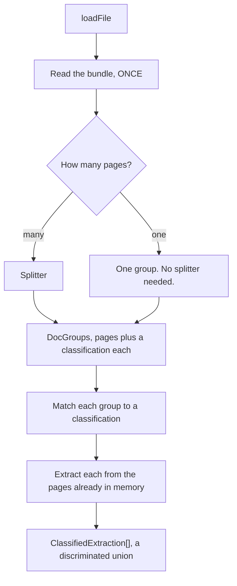

A scanned batch is routinely one PDF holding several unrelated things: two invoices, a
driving licence, a contract. Extracting it as one document is meaningless.

`Extractor` answers *what is in this document?* `Process` answers *what documents are in
this file, and what is in each of them?*

```ts
import { ImageSplitter, Process, SplittingStrategy } from "docture";

const documents = await new Process()
  .loadSplitter(new ImageSplitter({ model: openai("gpt-5") }))
  .loadExtractor(extractor)
  .loadFile("batch.pdf")
  .split([invoice, licence], SplittingStrategy.EAGER)
  .extract();

for (const d of documents) {
  d.pages;                                         // which pages of the scan it was
  if (d.name === "invoice") d.data.invoiceNumber;   // narrowed
  else                      d.data.licenceNumber;   // narrowed
}
```

## The flow



## `split` is lazy

It records the plan and returns immediately. Nothing is read and no model is called until
`extract`. That is what lets the chain read in one breath with a single `await`.

It also captures the classification list in the **type**, which is the real payoff:
`extract()` returns a discriminated union, so narrowing on `name` narrows `data`.

## The bundle is read once

Each document is extracted from the pages already in memory, not re-parsed. Internally
that is a `LoadedSource`, a document that has already been read and offered as a source,
so the load stage is skipped entirely. You can use it directly too.

```ts
await extractor.extract({ loaded: myAlreadyParsedDocument }, Invoice);
```

Page numbers are preserved rather than renumbered from 1, so a report can still say *the
invoice was pages 4 to 6 of the scan*.

## Eager and lazy

| | What it does | When |
|---|---|---|
| `SplittingStrategy.EAGER` | One request over the whole bundle | Fewer calls; needs it all to fit |
| `SplittingStrategy.LAZY` | One request per page *seam*, so `n-1` for `n` pages | Scales to long bundles |

`EAGER` on a splitter that has no eager implementation degrades to `LAZY` rather than
throwing: the strategy is a cost preference, and losing it should not lose the answer.

## Text or images

| Splitter | Reads | Requires |
|---|---|---|
| `TextSplitter` | Page text | `TEXT_LAYER` |
| `ImageSplitter` | A picture of the page | `RENDERABLE_PAGES` |

`requires` is checked before the splitter runs, so handing `ImageSplitter` a text-only
bundle fails at the wiring line rather than on page 40. For a scanned bundle, compose a
rasterizer:

```ts
withRasterizer(new DocumentLoaderPdfJs(), new NapiCanvasRasterizer({ dpi: 300 }))
```

## Writing your own

A splitter answers one question. Core does the folding, so an image splitter and a text
splitter cannot disagree about what a run of "same document" answers *means*.

```ts
const splitter = defineSplitter({
  name: "heading-splitter",
  requires: ["TEXT_LAYER"],
  async belongsToSameDocument(first, second, ctx) {
    return {
      belongsToSameDocument: !/^INVOICE\b/m.test(second.text),
      classificationPage1: "invoice",
      classificationPage2: "invoice",
    };
  },
});
```

`splitEager` is optional. The shared fold is `aggregateDocGroups`, and the shared
windowing is `pageWindows`. Both are exported, and both are tested on their own.

<Callout type="warn" title="A page is never dropped">
`aggregateDocGroups` takes the page count, so a splitter that under-reports truncates the
last group instead of losing pages. `ImageSplitter` and `TextSplitter` adopt any page the
model forgot into the document before it. Pages that fall out of a bundle are exactly the
ones nobody notices are missing.
</Callout>

## Groups nobody claimed

A group whose classification is not in your list is an error. `UnclassifiedGroupError`
names the pages and what they were called. Drop them deliberately if that is what you
want.

```ts
await process.extract({ onUnclassified: "skip" });
```

## What the cut cost

Deciding where a bundle divides is not free. `LAZY` over 60 pages is 59 requests.
`process.lastSplit` reports it.

```ts
process.lastSplit;
// { splitter: "ImageSplitter", strategy: "eager", groups: [...], usage: { … } }
```

A cost report that omits the split is wrong rather than incomplete.

## A cheaper model per kind

A classification can carry its own extractor. A receipt is three fields and deserves a
cheap model; a 40-page contract is not:

```ts
const receipt = defineClassification({
  name: "receipt",
  description: "A till receipt.",
  schema: Receipt,
  extractor: cheapExtractor,
});
```

## A worked example

`apps/examples/11-bundles-and-splitting` in the repo does this to a real six-page bank
statement that holds a checking account on pages 1 to 3, a credit line on pages 4 to 5,
and a blank reconciliation form on page 6 that belongs to neither.

```sh
pnpm --filter @docture/examples fetch
pnpm --filter @docture/examples bundles
```

Its splitter reads account headings, so the whole thing costs no tokens.

## Related

<Cards>
  <Card title="Classification" href="/docs/concepts/classification" description="Deciding what kind of document this is." />
  <Card title="Contracts" href="/docs/concepts/contracts" description="A schema that knows its own name." />
  <Card title="Rasterizers" href="/docs/concepts/rasterizers" description="Turning pages into pixels." />
</Cards>
