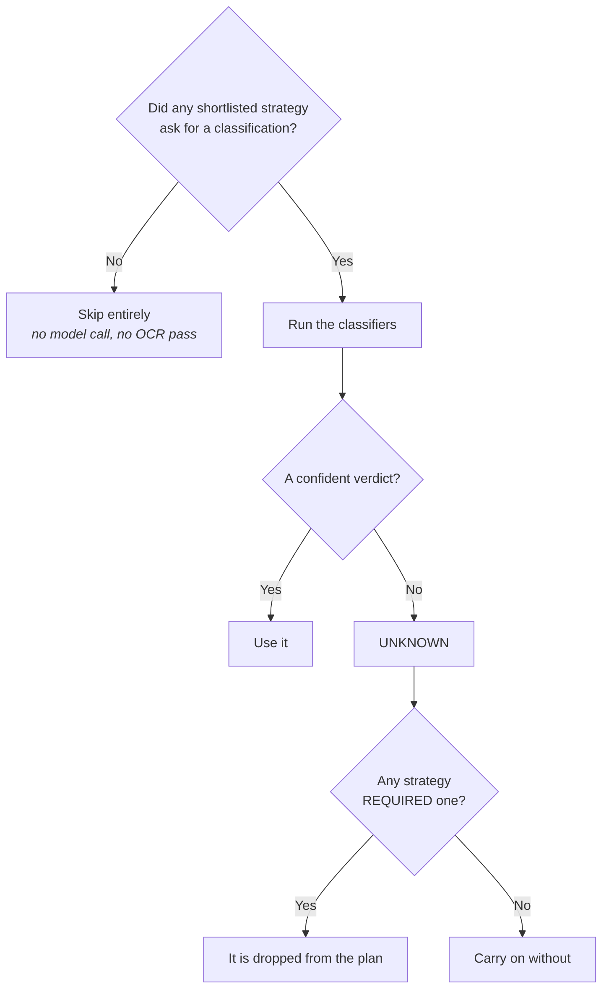
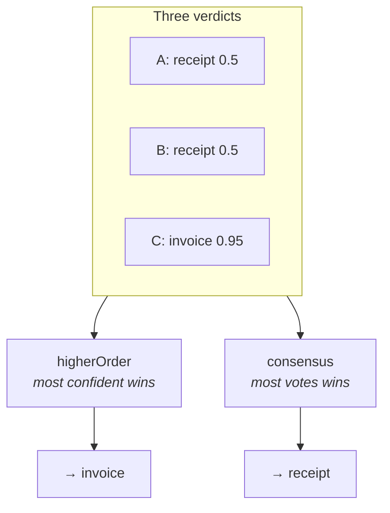

Classification answers "**what kind of document is this?**" so the right schema and the
right parser get used.

You need it when one pipeline handles several document kinds. If you only ever process
invoices, skip this page.

## Defining a kind

Each kind carries **its own schema**:

```ts
import { defineClassification } from "@docture/core";

const invoice = defineClassification({
  name: "invoice",
  description: "A commercial invoice with line items and a total",
  schema: Invoice,
});

const receipt = defineClassification({
  name: "receipt",
  description: "A point-of-sale receipt with a merchant name",
  schema: Receipt,
});
```

The `description` is what a classifier reads to recognise the kind, so write it the way
you would describe it to a new colleague.

## The payoff is type-level

Because each kind carries its own schema, narrowing on `name` **narrows `data`**:

```ts
if (r.name === "invoice") {
  r.data.invoiceNumber;   // Invoice
} else {
  r.data.merchantName;    // Receipt
}
```

```mermaid
flowchart LR
    R["Result"] --> Q{"r.name"}
    Q -->|'"invoice"'| A["r.data is Invoice<br/><i>invoiceNumber, lineItems…</i>"]
    Q -->|'"receipt"'| B["r.data is Receipt<br/><i>merchantName, paidAt…</i>"]
```

A discriminated union, from a runtime decision. The classifier chose while the program was
running, and the compiler still knows which fields each branch has.

## It only runs if something asks

Classification is **demand-driven**. Every strategy declares whether it wants one:

| `needsClassification` | Means |
|---|---|
| `"none"` | never classify for me |
| `"hint"` *(default for `llm`)* | use one if there is one, fine without |
| `"required"` | do not run me without one |



## Classifying with a model

```ts
import { llmClassifier } from "@docture/llm";

createExtractor({
  loaders: [new DocumentLoaderPdfJs()],
  strategies: [llm({ model: openai("gpt-5") })],
  classifiers: [llmClassifier({ model: openai("gpt-5-mini") })],
  classifications: [invoice, receipt],
});
```

It is deliberately cheap: it sends a **text excerpt** (4000 characters by default), not the
whole document, and asks only for a name and a confidence. Classifying with the same
budget as extracting would defeat the point, so a smaller, cheaper model is usually the
right call here.

## A classifier never throws

That is part of the contract. A model outage, a refusal, or a name that is not one of your
candidates all become **abstentions with a note**:

```ts
result.classification;
// {
//   name: "invoice",
//   confidence: 0.94,
//   signals: [
//     { classifier: "llm-classifier", name: "invoice", confidence: 0.94, reason: "…" },
//     { classifier: "anchors", name: null, confidence: 0, note: "threw: …" },
//   ],
// }
```

Failing the document would deny a later classifier, or the `UNKNOWN` path, its turn. A
broken classifier should not be able to break a run.

## Several classifiers disagreeing

Register more than one and choose how verdicts are reconciled:

```ts
import { ClassificationStrategy } from "docture";

new Extractor({
  /* … */
  classify: { strategy: ClassificationStrategy.CONSENSUS, threshold: 0.7 },
});
```

`ClassificationStrategy.CONSENSUS` **is** the string `"consensus"`. It is a frozen object
plus a type of the same name, so the constant autocompletes and the bare string still
type-checks. Same for `CompletionStrategy` and `SplittingStrategy`.



| Strategy | Picks |
|---|---|
| `higherOrder` *(default)* | the single most confident verdict |
| `consensus` | the most-voted name, ties broken by summed confidence |
| `consensusWithThreshold` | consensus, but `UNKNOWN` below `threshold` |

<Callout title="A verdict must name a candidate">
A classifier that answers `"Bill of Lading"` when the candidates are `invoice` and
`receipt` does not get to win. The name is reconciled against the candidate list, and an
answer that matches nothing becomes `UNKNOWN`. Matching is case-insensitive and reports
the *candidate's* spelling, since a model will happily return `"Invoice"` for a candidate
named `"invoice"`. The original answer stays in `signals`, so the disagreement is still
visible.

Without this, `name` would be an arbitrary string and the literal union above would be a
lie.
</Callout>

## Classifying on its own

```ts
const verdict = await extractor.classify("mystery.pdf", [invoice, receipt]);
verdict.name;            // "invoice" | "receipt" | "UNKNOWN"
verdict.confidence;      // 0 to 1
verdict.classification;  // the matched candidate, undefined exactly when UNKNOWN
verdict.signals;         // every classifier's opinion, abstentions included
```

Useful for routing a document to a different queue before deciding to extract at all.

## A tree, when there are too many kinds

Asking one model to choose between forty kinds is expensive and inaccurate. Asking it to
choose between four families, then between the winner's members, is neither:

```ts
import { classificationNode, classificationTree } from "docture";

const tree = classificationTree([
  classificationNode(financial, [
    classificationNode(invoice),
    classificationNode(receipt),
  ]),
  classificationNode(identity, [classificationNode(licence)]),
]);

const { leaf, path } = await extractor.classifyTree("mystery.pdf", tree);
leaf.name;                     // "receipt"
path.map((p) => p.name);       // ["financial", "receipt"], every verdict on the way down
```

Descent stops at a node with no children, or as soon as a level cannot be decided.
`Extractor.flatten(tree)` gives every kind depth-first.

## A different extractor per kind

A receipt is three fields and deserves a cheap model; a 40-page contract is not. A
classification can carry its own extractor, and its own extraction contract:

```ts
const receipt = defineClassification({
  name: "receipt",
  description: "A point-of-sale receipt with a merchant name",
  schema: ReceiptMarker,          // cheap, just enough to recognise it
  extractionContract: Receipt,    // the real payload, and what `data` is typed from
  extractor: cheapExtractor,      // a smaller model
});
```

Both are used by [`Process`](/docs/concepts/bundles-and-splitters) when it extracts each
document out of a bundle.

## Writing your own

Cheaper and more reliable than a model when the documents have a recognisable marker:

```ts
import { defineClassifier } from "@docture/core";

export const anchorClassifier = defineClassifier({
  name: "anchors",
  requires: ["TEXT_LAYER"],
  async classify(ctx) {
    const text = ctx.document.text.toLowerCase();
    if (text.includes("mautaufstellung")) {
      return { classifier: "anchors", name: "toll-statement", confidence: 0.99 };
    }
    return null;  // abstain, and let the next classifier decide
  },
});
```

Return `null` to abstain. Never throw.
