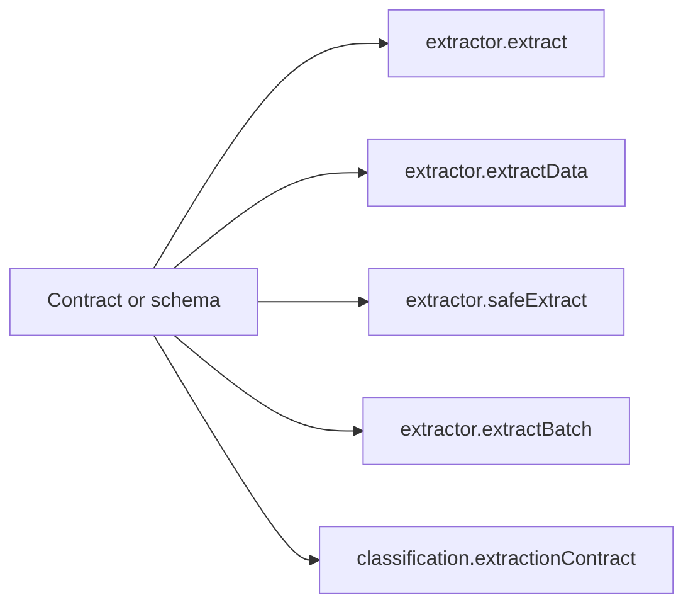

A **contract** is a schema plus the prose that describes it. Nothing more:

```ts
import { contract } from "docture";
import { z } from "zod";

export const Invoice = contract({
  name: "invoice",
  description: "A commercial invoice with a total and line items.",
  schema: z.object({
    invoiceNumber: z.string().describe("The invoice number, usually top-right"),
    total: z.number(),
  }),
  hints: "Amounts may use a comma as the decimal separator.",
});
```

## Why the wrapper exists

In Python, a Pydantic contract is a class, so the class name *is* the document's name
and the docstring *is* its description. Both are available at run time, for free.

TypeScript types are erased. A `z.object({ … })` has no name once it is running, so
nothing downstream can put "invoice" in a prompt, a classification list, or a report. A
contract is that pairing made explicit.

## It is always optional

Every call that takes a contract also takes a bare schema. These are the same:

```ts
await extractor.extract("invoice.pdf", Invoice);                 // named
await extractor.extract("invoice.pdf", z.object({ … }));         // not named
```

The inferred type of `result.data` is identical either way. Name a schema when
something reads the name; skip it when nothing does.

<Callout title="A lone contract classifies itself">
Extracting against a contract, with no `classifications` wired, offers that contract to
strategies as its own single-candidate classification. So the name and description you
already wrote reach the prompt without being repeated in an options bag.
</Callout>

## What accepts a contract



`ContractLike` is the union of the two, `Contract | FlexibleSchema`. `InferContract<C>` is
the data type either produces.

## Structural, not branded

`isContract` is a structural check: an object with a string `name` and a `schema`. So a
hand-written literal is a contract, with no need to have gone through `contract()`:

```ts
const Invoice: Contract<{ total: number }> = {
  name: "invoice",
  schema: z.object({ total: z.number() }),
};
```

That check is unambiguous against every member of the AI SDK's `FlexibleSchema` union: a
Zod schema has neither field, a `Schema` has no `name`, and a `LazySchema` is a function.

## Two contracts for one kind

A [classification](/docs/concepts/classification) can recognise a document with one
contract and extract it with another. Recognising an invoice needs two fields;
extracting one needs forty, and paying for forty on the classification pass is waste:

```ts
const invoice = defineClassification({
  name: "invoice",
  description: "A commercial invoice.",
  schema: z.object({ invoiceNumber: z.string() }),        // cheap, for recognising
  extractionContract: FullInvoice,                        // the real payload
});
```

`data` is then typed from `extractionContract`. The narrowing follows the contract that
actually produced the value, not the one that named it.

## Related

<Cards>
  <Card title="Schemas and types" href="/docs/concepts/schemas-and-types" description="Zod, Valibot, ArkType, raw JSON Schema." />
  <Card title="Classification" href="/docs/concepts/classification" description="Deciding what kind of document this is." />
  <Card title="Bundles and splitters" href="/docs/concepts/bundles-and-splitters" description="One scan, eleven documents." />
</Cards>
