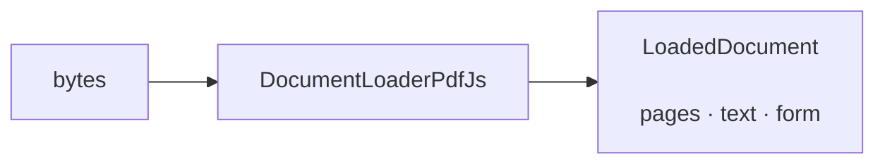
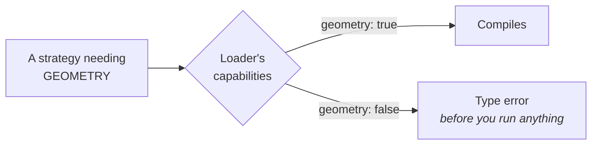
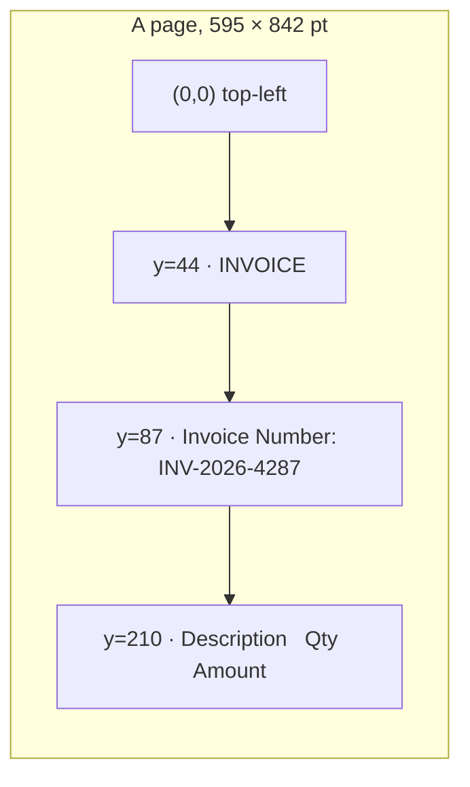

A loader turns bytes into pages of text, and, when it can, text with positions.



## The library is in the name

There is no `pdfTextLayer()` hiding a choice you did not make. Swapping libraries is
swapping an import:

```ts
import { DocumentLoaderPdfJs } from "@docture/loader-pdfjs";           // Mozilla PDF.js
import { DocumentLoaderMuPdf } from "@docture/loader-mupdf";           // MuPDF (WASM)
import { DocumentLoaderTesseract } from "@docture/loader-tesseract"; // Tesseract (WASM OCR)
import { DocumentLoaderPaddleOcr } from "@docture/loader-paddleocr";   // PaddleOCR (ONNX OCR)
```

Every loader package runs the same conformance suite against its own class. The same
checks for page numbering, text/page consistency, geometry ordering, scanned documents,
aborts and disposal. That is what makes two loaders genuinely interchangeable rather than
just similarly shaped.

<Callout title="Available today">
All four above are shipped and pass the same suite, a text layer and an OCR pass held to the
same invariants. That is also what makes **two** OCR engines a real choice rather than a
migration: see [PaddleOCR or Tesseract](/docs/reference/packages#paddleocr-or-tesseract). The
others are planned and purely additive: a new package plus one line in its test file. See
[Packages](/docs/reference/packages).
</Callout>

## Capabilities

Every loader declares what it can do. Three booleans and a list of media types.

```ts
new DocumentLoaderPdfJs().capabilities;
// { text: true, geometry: true, images: false, mimeTypes: ["application/pdf"] }
```

| | Means |
|---|---|
| `text` | produces page text |
| `geometry` | produces positioned line and word boxes, not just a text blob |
| `images` | can render pages to images |

These are **types**, not just values. A strategy that needs positioned geometry will not
accept a loader that cannot produce it:

```ts
// GeometryLoader requires geometry: true
const ok: GeometryLoader = new DocumentLoaderPdfJs();   // 
const no: GeometryLoader = textOnlyLoader;      // Type error
```

A wiring mistake is a **compile error at the call site**, not a throw halfway through
someone's 400-page document.



## What a loader gives you

```ts
{
  pages: [
    {
      pageNumber: 1,          // 1-based
      width: 595, height: 842, // PDF points
      text: "INVOICE\nInvoice Number: INV-2026-4287\n…",
      lines: [
        { y: 44, height: 20, text: "INVOICE", spans: [ … ] },
        { y: 87, height: 10, text: "Invoice Number: INV-2026-4287", spans: [ … ] },
      ],
    },
  ],
  text: "…",          // every page, joined by a form feed
  form: "digital",    // "digital" | "scanned" | "mixed" | "unknown"
  loader: "pdfjs",
}
```

### Coordinates

PDF points, **top-left origin, y increasing downward**. `lines` is sorted top-to-bottom,
each line's `spans` left-to-right.



Chosen because that is what OCR engines report natively, so no loader flips an axis and
no parser has to ask which way is up.

### `form` tells you what kind of document it was

| | |
|---|---|
| `digital` | every page has real text |
| `scanned` | no page does, it is images |
| `mixed` | some pages do (a digital invoice with a scanned annex) |
| `unknown` | the loader does not read text at all |

A scanned PDF yields `form: "scanned"` and empty text rather than nonsense, which is why
a text-layer strategy is simply not a candidate for it.

## Several loaders, in order

Listing more than one gives you a fallback chain:

```ts
createExtractor({
  loaders: [new DocumentLoaderPdfJs(), new DocumentLoaderMuPdf()],
  strategies: [ … ],
});
```

The first that accepts the media type and does not throw wins. A loader that fails is
recorded in `result.attempts`, so a document that only the second loader could open is
visible rather than mysterious.

Loaders can also cover different formats: one for PDFs, one for `.docx`, one for
HTML. Media types decide which are even candidates.

## Writing your own

A loader is a plain object. No base class.

```ts
import { defineLoader, inferForm } from "@docture/core";

export const myLoader = defineLoader({
  name: "acme",
  capabilities: {
    text: true,
    geometry: false,
    images: false,
    mimeTypes: ["text/plain"],
  },
  async load(document, ctx) {
    ctx.signal.throwIfAborted();
    const text = Buffer.from(document.bytes).toString("utf8");
    return {
      pages: [{ pageNumber: 1, width: 0, height: 0, text }],
      text,
      form: inferForm([text.trim().length]),
      loader: "acme",
    };
  },
});
```

`defineLoader` is optional. It only pins the capability literals so the compile-time
check above keeps working. See [Write your own loader](/docs/guides/custom-loader) for a
loader with real geometry.

<Cards>
  <Card title="Rasterizers" href="/docs/concepts/rasterizers" description="Rendering pages, as a separate choice." />
  <Card title="Write your own loader" href="/docs/guides/custom-loader" description="Including positioned geometry." />
</Cards>
