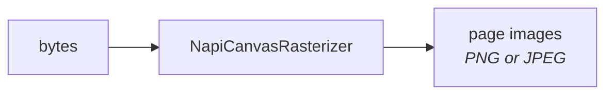
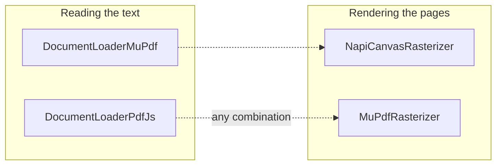
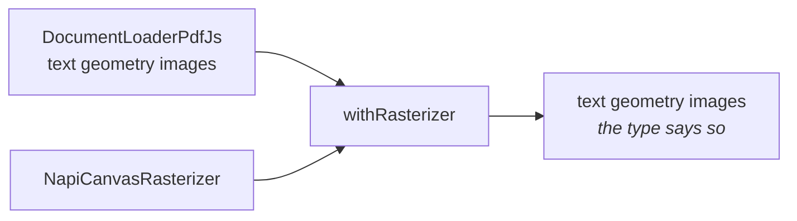
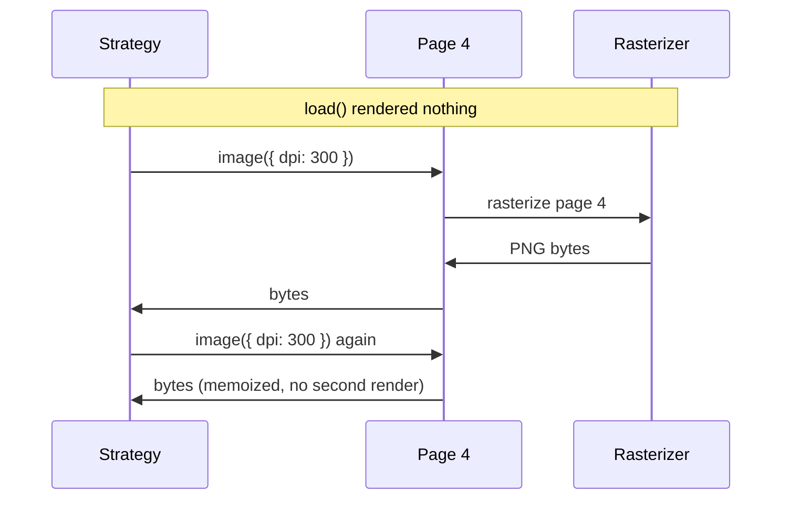
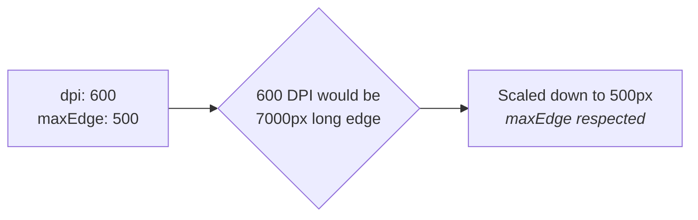

A **rasterizer** turns pages into images. It is a separate plugin from a loader, on
purpose.



## Why separate?

Reading text and rendering pages are different jobs, and the best library for one is often
not the best for the other. Bundling them together would mean choosing an OCR engine also
chooses how pages get rendered. Here the two are independent, and you can mix them:



Both pairs above ship today. `NapiCanvasRasterizer` is pdf.js drawing onto a native canvas
binding; `MuPdfRasterizer` rasterizes inside WASM and encodes the image itself, so it needs no
prebuilt binary for your platform, at the cost of blocking the event loop while it works, and
of MuPDF's [AGPL licence](/docs/reference/packages#mupdf-is-agpl-licensed).

## Composing the two

`withRasterizer` gives a loader the ability to render, and the return type says so.

```ts
import { withRasterizer } from "@docture/core";
import { DocumentLoaderPdfJs } from "@docture/loader-pdfjs";
import { NapiCanvasRasterizer } from "@docture/raster-canvas";

const loader = withRasterizer(new DocumentLoaderPdfJs(), new NapiCanvasRasterizer({ dpi: 300 }));

loader.capabilities.images;        // true
new DocumentLoaderPdfJs().capabilities.images;  // false
loader.name;                       // "pdfjs+napi-canvas"
```



Because `images` becomes `true` in the type, a strategy that requires rendering accepts
the composition and rejects the bare loader. The compiler checks it.

## Images are lazy

Every page gets an `image()` function. **Nothing renders until you call it**, and asking
twice for the same page renders once.



That matters at scale: a 200-page document that a strategy looks at two pages of costs
**two renders**, not 200. Rendering the whole document up front would pay for all 200.

```ts
const document = await loader.load(raw, ctx);
const png = await document.pages[3]?.image?.({ dpi: 300 });
```

To render many pages at once, call the rasterizer directly instead.

## Options

Set defaults on the constructor; override per call.

```ts
new NapiCanvasRasterizer({ dpi: 300, format: "png" });
await page.image({ dpi: 150, maxEdge: 1600 });
```

| Option | Default | |
|---|---|---|
| `dpi` | `300` | 300 for OCR; ~200 is plenty for a vision model |
| `format` | `"png"` | `"png"` or `"jpeg"` |
| `quality` | `0.9` | JPEG only, 0 to 1 |
| `maxEdge` | none | cap the long edge in pixels |
| `pages` | all | 1-based page numbers |

### `maxEdge` wins over `dpi`

When they conflict, the cap wins. Whoever set it did so to fit a downstream
limit that overshooting would breach.



### Mapping pixels back to points

`RasterPage.scale` is points per pixel, computed from what the rasterizer actually
produced, so
it stays correct after a `maxEdge` downscale.

```ts
const page = pages[0];
page.scale * page.widthPx;  // ~595.28, the page width in points
```

That is how an OCR loader converts pixel boxes into the PDF-point coordinates the rest of
the library uses.

<Cards>
  <Card title="Scanned documents" href="/docs/guides/scanned-documents" description="Rendering pages for a vision model." />
  <Card title="Loaders" href="/docs/concepts/loaders" description="The reading half of the pair." />
</Cards>
