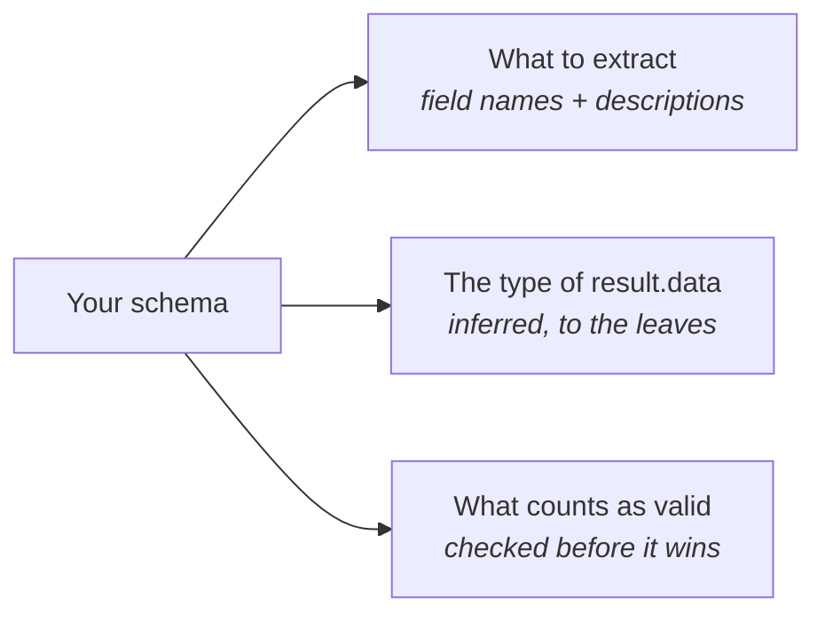
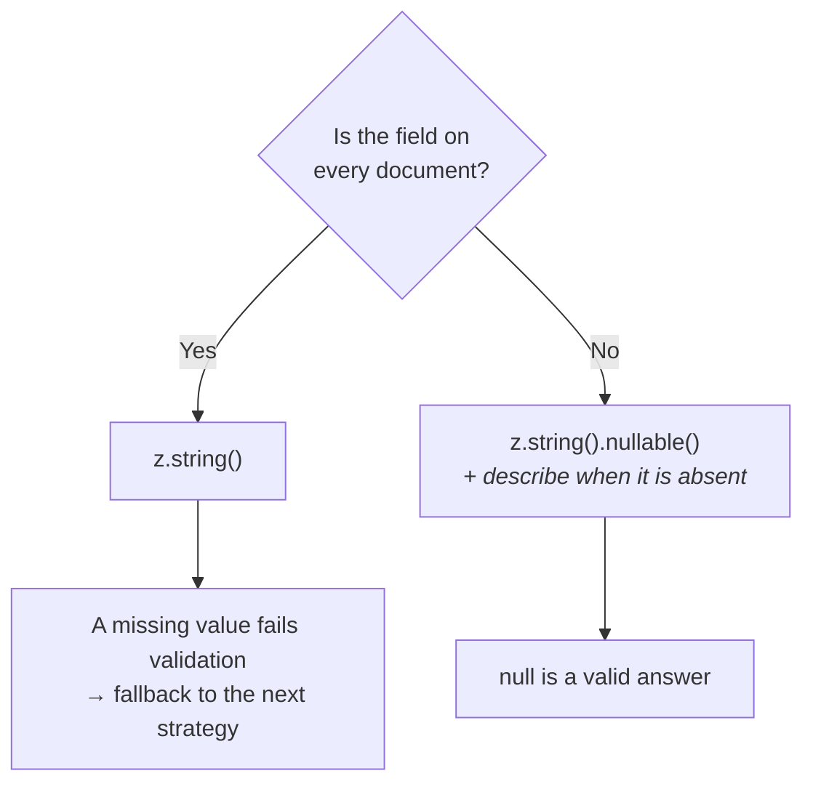

The schema does two jobs at once: it **tells the extractor what to look for**, and it
**gives TypeScript the shape of the answer**.



## Bring your own schema library

docture does not invent a schema type. It uses the **AI SDK's `FlexibleSchema`**, which
already accepts:

- Zod, the default in these docs
- **Valibot**
- **ArkType**
- Any other **Standard Schema** library
- Plain **JSON Schema**

```ts
// Zod
const Invoice = z.object({ total: z.number() });

// Valibot
const Invoice = v.object({ total: v.number() });

// JSON Schema
const Invoice = jsonSchema<{ total: number }>({
  type: "object",
  properties: { total: { type: "number" } },
  required: ["total"],
});
```

<Callout title="Why reuse the AI SDK's type?">
Because it already solved this, and reusing it means your schema reaches `generateObject`
in its original form. Zod stays Zod, so refinements and descriptions get to the
provider instead of surviving a lossy round trip through JSON Schema.
</Callout>

## The typing

```ts
extract<S extends FlexibleSchema>(
  source: DocumentSource,
  schema: S,
): Promise<ExtractionResult<InferSchema<S>>>;
```

`InferSchema<S>` is what makes `result.data` real:

```ts
const result = await extractor.extract("invoice.pdf", Invoice);

result.data.lineItems[0]?.amount;  // number | undefined
result.data.vatNumber;             // Type error, not in the schema
```

No cast, no `as`, no contract class to declare.

## Writing a schema that extracts well

**Field names are prompt.** A model reads them, so name fields the way the document does.

```ts
// obvious from the name
z.object({ invoiceNumber: z.string(), issuedAt: z.string() })

// ambiguous
z.object({ num: z.string(), d1: z.string() })
```

Use `.describe()` when the name is not enough, for a location, a format, or a rule.

```ts
z.object({
  invoiceNumber: z.string().describe("The invoice number, usually top-right"),
  issuedAt: z.string().describe("Issue date, normalised to ISO 8601 (YYYY-MM-DD)"),
  total: z.number().describe("Grand total including tax, as a plain number"),
  taxRate: z.number().describe("As a fraction, so 19% is 0.19"),
});
```

**Make genuinely-optional fields nullable.** If a field is absent from some documents,
say so. Otherwise a valid extraction fails validation.

```ts
z.object({
  purchaseOrder: z.string().nullable().describe("PO number; null if not present"),
});
```



**Amounts as numbers, not strings.** The default prompt already tells a model to strip
currency symbols and thousands separators, so `z.number()` gets you `1234.56` rather than
`"€1.234,56"`.

## Validation

The pipeline validates once, in one place, whatever produced the data.

```ts
result.validation;  // { valid: true, issues: [] }
```

A failure is a failed attempt, not a dead run, so the next strategy gets a turn. If
every strategy fails validation you get `ContractViolationError` with the issues, which is
the more actionable diagnosis than "they all threw":

```ts
catch (error) {
  if (error.code === "CONTRACT_VIOLATION") {
    error.issues;  // [{ path: "lineItems.2.amount", message: "expected number" }]
  }
}
```

<Callout title="Plain JSON Schema has no validator">
A hand-written JSON Schema carries no runtime validator, so validation passes the data
through. The JSON Schema still reaches the model for prompting. Use Zod or Valibot if you
want the check.
</Callout>

## Deriving values

If a field is arithmetic rather than something printed on the page, compute it rather than
asking a model to:

```ts
const result = await extractor.extract("invoice.pdf", Invoice);

const withDerived = {
  ...result.data,
  netTotal: round2(result.data.total - result.data.tax),
};
```

Cheaper, exact, and it cannot hallucinate.
