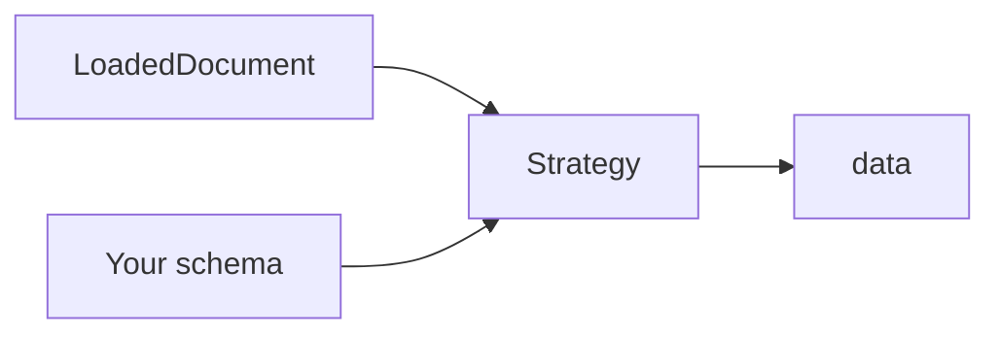
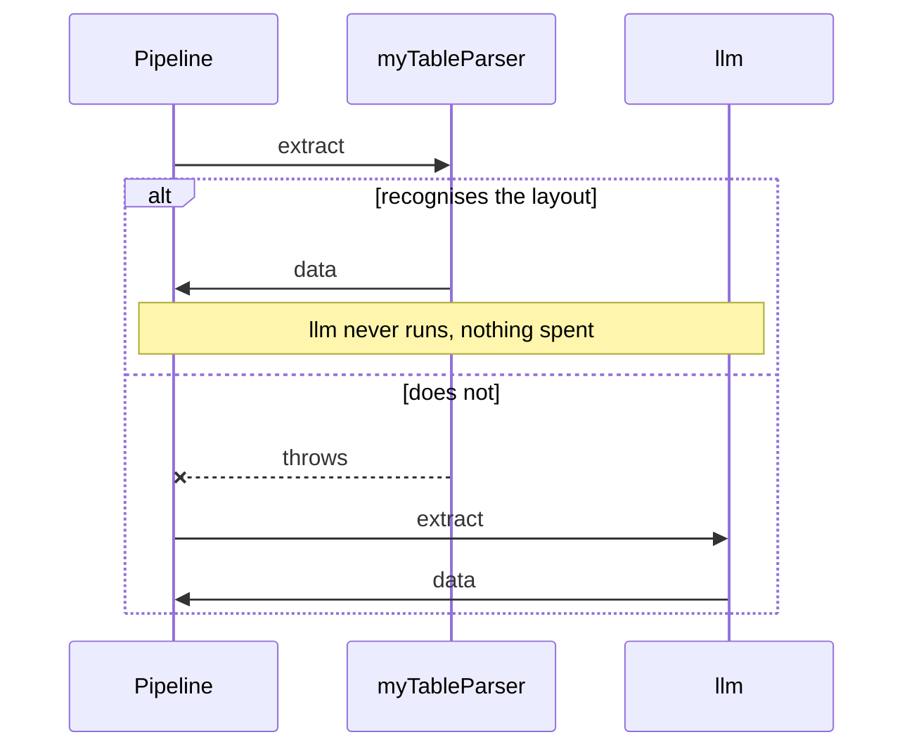
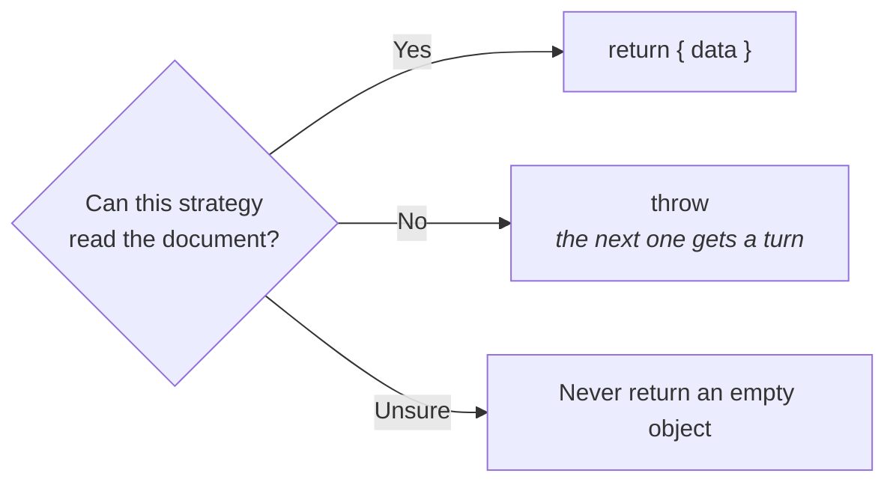
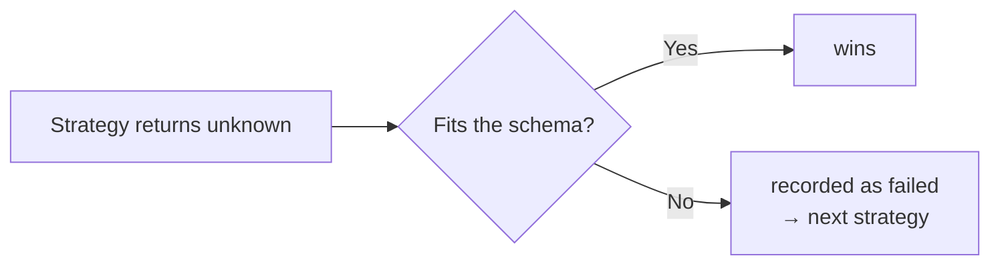

A **strategy** takes a loaded document and produces the data. It is the "understanding"
half of the library. The loader only reads.



## The three that ship

| | Reads | Costs |
|---|---|---|
| `llm(…)` | the document's **text** | a model call |
| `vision(…)` | the document's **page images** | a model call, usually more |
| your own | whatever you like | nothing |

## Order is the policy

Strategies run **in the order you declare them**. The first that does not throw wins.
That is the whole routing rule. There is no hidden precedence to learn.

```ts
createExtractor({
  loaders: [new DocumentLoaderPdfJs()],
  strategies: [
    myTableParser,                   // free, so try it first
    llm({ model: openai("gpt-5") }), // costs money, so it is the fallback
  ],
});
```



A known layout costs nothing; an unfamiliar one falls through to the model. That is the
pattern most real projects want.

## A strategy declares what it needs

```ts
{
  name: "myTableParser",
  requires: ["TEXT_LAYER", "GEOMETRY"],
}
```

A strategy whose requirements the document fails is **never a candidate**. `requires` is
about the *document*, not about wiring. An engine, a model client or a rasterizer is a
**constructor argument** instead, so "no model wired" is a compile error at the wiring
site rather than a throw partway through a run.

## A strategy must not abstain

Either produce data, or **throw**.



Why: an empty result is indistinguishable from a real one for a document that genuinely
has no rows. A strategy that returns `{}` when it is lost silently claims success and
blocks the fallback.

## Strategies do not validate

A strategy returns `data: unknown`; the **pipeline** validates it against your schema.



Two consequences:

- A wrong shape is **recoverable**, not fatal.
- `validation` means one thing regardless of who answered.

## Writing your own

```ts
import { defineStrategy } from "@docture/core";

export const myTableParser = defineStrategy({
  name: "table-parser",
  requires: ["TEXT_LAYER", "GEOMETRY"],

  async extract(ctx) {
    const lines = ctx.document.pages.flatMap((p) => (p.lines ?? []).map((l) => l.text));

    const invoiceNumber = lines
      .find((l) => l.startsWith("Invoice Number:"))
      ?.slice("Invoice Number:".length)
      .trim();

    // Not our layout. Let the next strategy try.
    if (invoiceNumber === undefined) throw new Error("no 'Invoice Number:' line found");

    return { data: { invoiceNumber /* … */ } };
  },
});
```

What `ctx` gives you:

| | |
|---|---|
| `ctx.document` | pages, text, lines, `form` |
| `ctx.features` | what the document turned out to have |
| `ctx.schema` | `jsonSchema` for prompting, `validate`, and the original schema |
| `ctx.classification` | present when one was decided |
| `ctx.signal` | abort, check it before slow work |
| `ctx.logger` | ids and timings only, never document content |

See [Without a model](/docs/guides/without-a-model) for a complete worked parser.

## Reordering without rewriting

For anything order alone cannot express, pass a `policy`, a pure function that sees only
the **eligible** strategies:

```ts
createExtractor({
  loaders, strategies,
  policy: (features, eligible) =>
    features.pageCount > 20
      ? [...eligible].reverse()  // long documents: model first
      : eligible,
});
```

A policy cannot widen eligibility: returning a strategy it was not offered is ignored.

## Naming two of the same

`name` defaults to `"llm"`, so give each one its own when you register two:

```ts
strategies: [
  llm({ model: openai("gpt-5-mini"), name: "cheap" }),
  llm({ model: openai("gpt-5"), name: "careful" }),
]
```

Two components under one name is a `DuplicateComponentError` at construction, never a
silent shadowing.

<Cards>
  <Card title="With a model" href="/docs/guides/with-a-model" description="Configuring llm() properly." />
  <Card title="Without a model" href="/docs/guides/without-a-model" description="A complete deterministic parser." />
</Cards>
