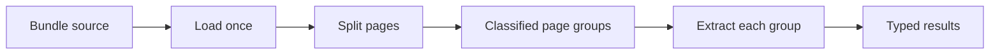

A bundle is one source containing several documents. `Process` loads the source once,
uses a splitter to assign page groups, and extracts each group with its matching
classification.



## Splitter contract

A splitter answers whether two adjacent pages belong to the same document. It also
reports the classification of each page and may report confidence.

```ts check
import { defineSplitter } from "docture";

const splitter = defineSplitter({
  name: "invoice-heading",
  requires: ["TEXT_LAYER"],
  async belongsToSameDocument(first, second) {
    return {
      belongsToSameDocument: !/^INVOICE/m.test(second.text),
      classificationPage1: "invoice",
      classificationPage2: "invoice",
    };
  },
});
```

Core folds the pairwise verdicts into ordered `DocGroup` values. Page numbers are
1-based and refer to the original source.

## Extract each group

Use the splitter above with a configured extractor and your declared document kinds:

```ts
import { Process } from "docture/node";
import { SplittingStrategy } from "docture";

const process = new Process()
	.loadExtractor(extractor)
	.loadSplitter(splitter)
	.loadFile("bundle.pdf")
	.split(kinds, SplittingStrategy.LAZY);
try {
	const documents = await process.extract();
	for (const item of documents) console.log(item.name, item.pages, item.data);
} finally {
	await process.dispose();
	await extractor.dispose();
}
```

Each result carries the kind's typed data and original page numbers. The configured extractor supplies loaders and extraction strategies. The process borrows it, so dispose the extractor yourself after its last use.

To run one configured process over several files, pass each source to `extract()`:

```ts
const results = await Promise.all(files.map((file) => process.extract(file)));
```

## Eager and lazy splitting

`SplittingStrategy.EAGER` lets a splitter inspect every page in one call through
`splitEager()`. When that method is absent, core uses the lazy path.

`SplittingStrategy.LAZY` checks adjacent page pairs with bounded concurrency. It is a
better fit when the full bundle cannot be sent in one request.

A one-page source is one group and does not call the splitter. With one candidate kind,
`Process` assigns that kind without classification. With several candidates, it may call
the default extractor's classifiers to name the group.

## Process lifecycle

`Process.split()` records the classification list and strategy. Loading and splitting
happen when `extract()` or `splitOnly()` is called.

The process can use its own loaders, splitter, default extractor, and logger. A
classification may override the default extractor for its document kind. The loaded
document is passed to each extraction, so the source is not read again. Each group is
extracted under the kind the split gave it, so the extractor's classifiers do not run
again for it. If one group fails, the groups still running are cancelled.

A splitter must place every page in exactly one group. A repeated, missing, or unknown
page fails the split with `SplitFailedError`, which names the pages.

Unclassified groups throw `UnclassifiedGroupError` by default. Set
`onUnclassified: "skip"` only when dropping those groups is an explicit choice.

`lastSplit` reports the splitter, strategy, groups, and splitting usage. Call
`dispose()`, or declare the process with `await using`, to release the splitter and the
loaders passed to `loadDocumentLoader()`. The extractor passed to `loadExtractor()` is
borrowed and stays open.

`docture/llm` ships `TextSplitter` for text layers and `ImageSplitter` for renderable
pages. Their functional forms are `textSplitter()` and `imageSplitter()`.

See the [LLM API](/docs/extraction/reference/models) for the shipped splitters and the
[classification and splitting API](/docs/extraction/reference/classification) for `Process`,
split reports, and core helpers.
