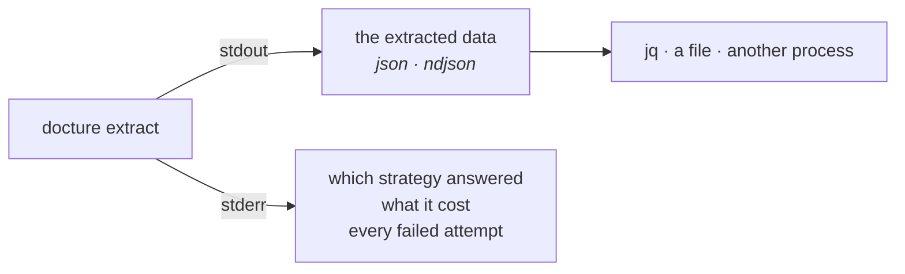
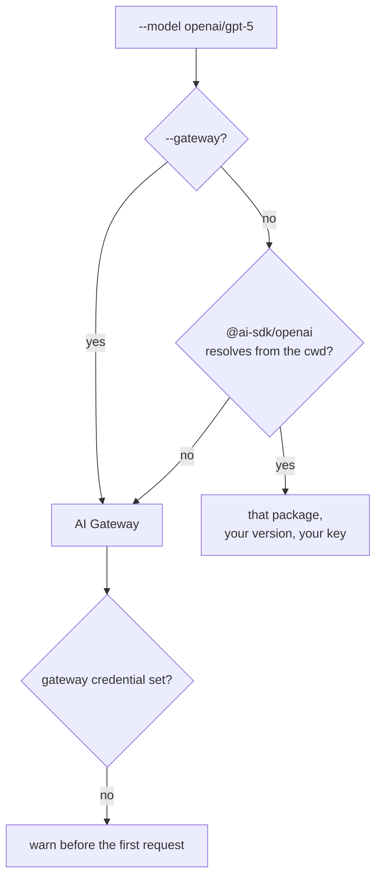

Everything in these guides, without writing a script.

```sh
npx docture extract invoice.pdf --schema ./invoice.ts --model openai/gpt-5
```

```json
{
  "invoiceNumber": "INV-2026-4311",
  "issuedAt": "2026-03-14",
  "total": 1284.5
}
```

## stdout is the data. stderr is the story.

The split is the whole design of the output. Data is pipeable; everything a human reads
goes to the other stream, so both are available at once and neither corrupts the other.

```sh
docture extract invoice.pdf -s ./invoice.ts -m openai/gpt-5 | jq .total
```

```
✓ invoice.pdf → llm via pdfjs · 2.1s · 3,412 tokens · $0.0041
```



## The four commands

| | |
|---|---|
| `extract <file...>` | Extract structured data |
| `classify <file...>` | Decide what kind of document it is, without extracting |
| `inspect <file...>` | What the loaders see. **No model, no API key** |
| `eval <file...>` | Score against ground truth, and gate CI on the number |

`docture <command> --help` prints every flag.

## The schema

`--schema` points at a module exporting whatever the library takes: Zod, Valibot,
ArkType, or raw JSON Schema. See [Schemas and types](/docs/concepts/schemas-and-types).

```ts title="invoice.ts"
import { z } from "zod";

export default z.object({
  invoiceNumber: z.string().describe("The invoice number, top-right"),
  issuedAt: z.string().describe("Issue date, ISO 8601"),
  total: z.number(),
});
```

TypeScript needs no build step: Node strips the types itself from 22.18 on. A module may
export `default`, `schema`, or exactly one thing. `--schema ./schemas.ts#Invoice`
names an export outright.

<Callout type="warn" title="A .json schema steers the model but cannot check it">
[Plain JSON Schema carries no runtime validator](/docs/concepts/schemas-and-types), so
the answer goes through unchecked. The CLI will not grow a JSON Schema engine to invent
one. It says so on stderr before printing anything. Export a Zod, Valibot or
ArkType schema when you want the check.
</Callout>

## The model

`--model <provider>/<model-id>`. Since a command line has no imports, the CLI has to
choose a provider, and the one thing it must not do is choose silently.



Which route was taken is printed by `--verbose`, and a missing credential is a warning
*before* anything is spent rather than a 401 after it.

```sh
docture extract invoice.pdf -s ./invoice.ts -m openai/gpt-5
docture extract invoice.pdf -s ./invoice.ts -m anthropic/claude-opus-5
docture extract invoice.pdf -s ./invoice.ts -m bedrock/claude-opus-5
```

## Scans

A scan has no text layer, so no text strategy is eligible for it. See
[Scanned documents](/docs/guides/scanned-documents). `--vision` composes a rasterizer
onto the loader and adds a vision strategy:

```sh
docture extract scan.pdf -s ./invoice.ts -m openai/gpt-5 --vision --dpi 200
```

Rendering comes from `@docture/raster-canvas`, the CLI's one **optional** dependency: it
carries a native binding, and a platform with no prebuild should still be able to install
a CLI that reads text. Missing, `--vision` fails by name.

## Batches

Every command takes many files, and a glob that survives your shell is expanded here.

```sh
docture extract 'invoices/*.pdf' -s ./invoice.ts -m openai/gpt-5 \
  --out out/ --cache .docture-cache --concurrency 8
```

- `--out <dir>` writes `out/<name>.json` per document; `--out <file>` collects one.
- `--format ndjson` streams `{ file, ok, data }` per line, as each finishes.
- `--full` adds `method`, `loader`, `attempts`, `usage` and `features` per record.
- `--cache <dir>` caches model responses, so re-running a corpus after a schema tweak
  only pays for what changed.

One bad document never sinks the rest. `extractBatch` yields failures as values, so a
corrupt scan in a batch of 500 loses that one and not the other 499.

### Exit codes

| | |
|---|---|
| `0` | Everything worked |
| `1` | A document failed, or an `--min-f1` gate was not met |
| `2` | The command was wrong: an unknown flag, no schema, an unresolvable model |

CI wants that distinction: **2 will fail identically on every rerun**, and **1 might not**.

## Why did nothing run?

`inspect` needs no model and no key. It prints the `features` that eligibility is
actually decided from:

```sh
$ docture inspect scan.pdf
scan.pdf
  loader      pdfjs
  type        application/pdf
  pages       3
  form        scanned
  text        0 chars
  geometry    no
  renderable  no

  a strategy requiring TEXT_LAYER ✗  GEOMETRY ✗  RENDERABLE_PAGES ✗
```

That report is not a second implementation of the rules in
[How it works](/docs/how-it-works). A probe strategy is pushed onto a real pipeline and
reports the features core handed it, so what you read is by construction what routing
used.

## docture.config.ts

When flags stop being enough, wire it in TypeScript. A config hands you the actual
libraries rather than a description of them:

```ts title="docture.config.ts"
import { defineConfig } from "@docture/cli";
import { DocumentLoaderPdfJs } from "@docture/loader-pdfjs";
import { llm } from "@docture/llm";
import { openai } from "@ai-sdk/openai";
import { Invoice } from "./schemas/invoice.js";
import { tableParser } from "./strategies/table.js";

export default defineConfig({
  loaders: [new DocumentLoaderPdfJs()],
  // Declaration order is the routing policy: the free parser goes first.
  strategies: [tableParser, llm({ model: openai("gpt-5") })],
  schema: Invoice,
  cacheDir: ".docture-cache",
});
```

That takes no flags at all. `docture extract invoice.pdf` is the whole command. The
nearest `docture.config.{ts,mts,js,mjs}` walking up from the working directory is used;
`--config` points elsewhere, `--no-config` ignores it.

Anything on the command line wins over anything in the config: a config is a default,
never an override. Where it cannot be, the run says so. A config supplying its own
`strategies` makes `--model` meaningless, and the run reports the flag as ignored rather
than quietly dropping it.

| Key | |
|---|---|
| `loaders`, `strategies`, `classifiers`, `classifications`, `policy` | passed to `createExtractor` |
| `model`, `vision`, `instructions`, `pricing` | build the default LLM strategies |
| `schema` | used when `--schema` is omitted |
| `cacheDir`, `concurrency`, `stageTimeoutMs` | run defaults |
| `extractor` | a built `Extractor`. Total control; everything above is ignored |

This is also how you reach a loader the CLI does not bundle:
[`DocumentLoaderMuPdf`](/docs/reference/packages#mupdf-is-agpl-licensed), `DocumentLoaderTesseract` or
`DocumentLoaderPaddleOcr`, say. Nothing AGPL-licensed and no ONNX runtime is pulled by installing
the CLI; either arrives only when your config imports it.

## Gating accuracy in CI

`eval` extracts a corpus, scores it with the grader from
[Measuring accuracy](/docs/guides/measuring-accuracy), the same one the library's own
tests use, and exits 1 below the gate.

```sh
docture eval 'corpus/*.pdf' -s ./invoice.ts -m openai/gpt-5 \
  --truth corpus/truth --min-f1 0.95 --report score.md
```

```
| Document | F1 | Precision | Recall | Exact | Method | Miss |
| --- | --- | --- | --- | --- | --- | --- |
inv-001.pdf | 1.000 | 100.0% | 100.0% | yes | llm | 0
inv-002.pdf | 0.947 | 100.0% | 90.0% | no | llm | 1

**2 documents** · mean F1 0.974 · 1 exact · 8,204 tokens · $0.0098 · 4210ms
```

Ground truth is `--truth <dir>/<name>.json`, or a `<name>.expected.json` beside each
document. A missing truth file fails the run **before** anything is sent to a model:
scoring a document against nothing and calling it 1.0 would be the worst thing this
command could do.

## Driving it from code

`run` is the whole CLI as a function of argv and an IO interface, which is how it is tested,
and how you would wrap it in a task runner:

```ts
import { captureIo, run } from "@docture/cli";

const io = captureIo({ cwd: process.cwd(), env: process.env });
const code = await run(["extract", "invoice.pdf", "-s", "./invoice.ts"], { io });

io.stdout; // the data
io.stderr; // the story
```
