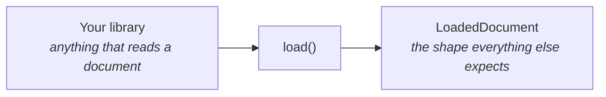
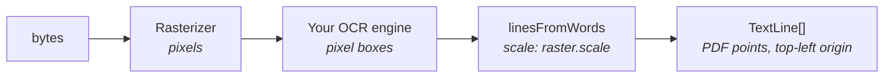

A loader is a **plain object**. There is no base class to extend, which means a real loader
and a test fake are the same kind of thing.



## The contract

```ts
interface DocumentLoader {
  readonly name: string;
  readonly capabilities: LoaderCapabilities;
  load(document: RawDocument, ctx: LoadContext): Promise<LoadedDocument>;
  dispose?(): Promise<void>;
}
```

Four rules the conformance suite checks:

1. **Number pages from 1**, in document order.
2. **Report `form` honestly.** Use `"scanned"` for a page with no text, not empty success.
3. **Throw on bytes you cannot read**, so the next loader gets a turn.
4. **Check `ctx.signal`** before slow work.

## A text loader

The simplest useful case is a format nothing else handles.

```ts title="csv-loader.ts"
import { defineLoader, inferForm } from "@docture/core";

export const csvLoader = defineLoader({
  name: "csv",
  capabilities: {
    text: true,
    geometry: false,
    images: false,
    mimeTypes: ["text/csv"],
  },

  async load(document, ctx) {
    ctx.signal.throwIfAborted();

    const text = Buffer.from(document.bytes).toString("utf8");
    if (text.trim() === "") throw new Error("csv: the file is empty");

    return {
      pages: [{ pageNumber: 1, width: 0, height: 0, text }],
      text,
      form: inferForm([text.trim().length]),
      loader: "csv",
    };
  },
});
```

`defineLoader` is optional. It only pins the capability literals so the compile-time
capability check keeps working.

## A loader with geometry

If your library reports **positioned words**, you get geometry almost for free.
`linesFromWords` is the shared grouper every geometry loader uses. It is in core precisely
so each one does not reinvent it (and drift).

```ts title="ocr-loader.ts"
import {
  defineLoader,
  linesFromWords,
  textFromLines,
  type PositionedWord,
  type Rasterizer,
} from "@docture/core";

interface Options {
  /** Required by construction: this loader cannot work without one. */
  readonly rasterizer: Rasterizer;
  readonly dpi?: number;
}

export function myOcrLoader({ rasterizer, dpi = 300 }: Options) {
  return defineLoader({
    name: "my-ocr",
    capabilities: {
      text: true,
      geometry: true,
      // `false` even though a rasterizer is right there: `images: true` promises that
      // every page has an `image()`, and this loader does not attach one. Claim it
      // only once you do. `DocumentLoaderTesseract` shows both halves.
      images: false,
      mimeTypes: ["application/pdf", "image/png", "image/jpeg"],
    },

    async load(document, ctx) {
      ctx.signal.throwIfAborted();

      const rendered = await rasterizer.rasterize(document, { dpi, format: "png" }, ctx);
      const pages = [];

      for (const raster of rendered) {
        ctx.signal.throwIfAborted();

        // Whatever your engine returns, in PIXELS.
        const detected = await runMyEngine(raster.bytes);

        const words: PositionedWord[] = detected.map((d) => ({
          text: d.text,
          box: [d.left, d.top, d.left + d.width, d.top + d.height],
          confidence: d.confidence,
        }));

        // `scale` is points-per-pixel, so this converts to PDF points.
        const lines = linesFromWords(words, { scale: raster.scale });

        pages.push({
          pageNumber: raster.pageNumber,
          width: raster.widthPx * raster.scale,
          height: raster.heightPx * raster.scale,
          text: textFromLines(lines),
          lines,
        });
      }

      return {
        pages,
        text: pages.map((p) => p.text).join("\f"),
        // OCR always produces text, so it is never "scanned" from here.
        form: "digital",
        loader: "my-ocr",
      };
    },

    async dispose() {
      await rasterizer.dispose?.();
    },
  });
}
```



Note the rasterizer is a **constructor argument**, not something looked up at run time.
That makes "no rasterizer wired" a compile error at the wiring site rather than a throw
partway through a document.

## Lazy heavy dependencies

If your library is large, import it at first use, so constructing the loader is free
and a pipeline that never uses it pays nothing:

```ts
let engine: Promise<Engine> | undefined;

async function getEngine(): Promise<Engine> {
  engine ??= import("some-huge-ocr-library").then((m) => m.create());
  return engine;
}
```

This is why `@docture/core` can promise that installing it pulls no PDF library.

## Prove it is interchangeable

Point the conformance suite at your class. That is the whole test file:

```ts title="test/loader.test.ts"
import { describeLoaderConformance } from "@docture/testing";
import { csvLoader } from "../src/csv-loader.js";

describeLoaderConformance({
  name: "csvLoader",
  create: () => csvLoader,
  // Opt out of checks the format genuinely cannot satisfy.
  skip: { geometry: true, images: true, multiPage: true },
});
```

It generates real fixtures, so you need no corpus of your own. If it passes, your loader is
a drop-in for any other.

<Callout title="A worked version of the sketch above">
[`@docture/loader-tesseract`](/docs/reference/packages) is this OCR loader done for real:
lazy engine load, a worker pool, pixel boxes converted to points, and the conformance suite
pointed at it. Worth reading next to the fifty-line version.
[`@docture/loader-paddleocr`](/docs/reference/packages#paddleocr-or-tesseract) is the same
sketch against a completely different library, which is the more instructive comparison: the
two share no engine code and produce interchangeable documents.
</Callout>
