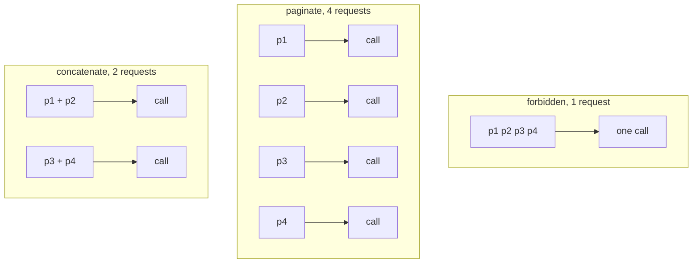
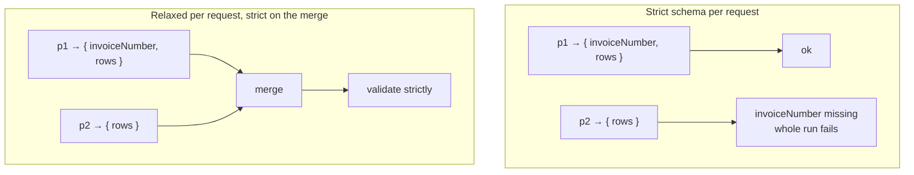
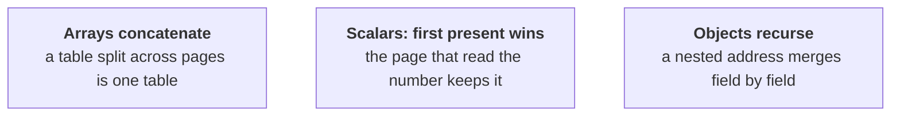
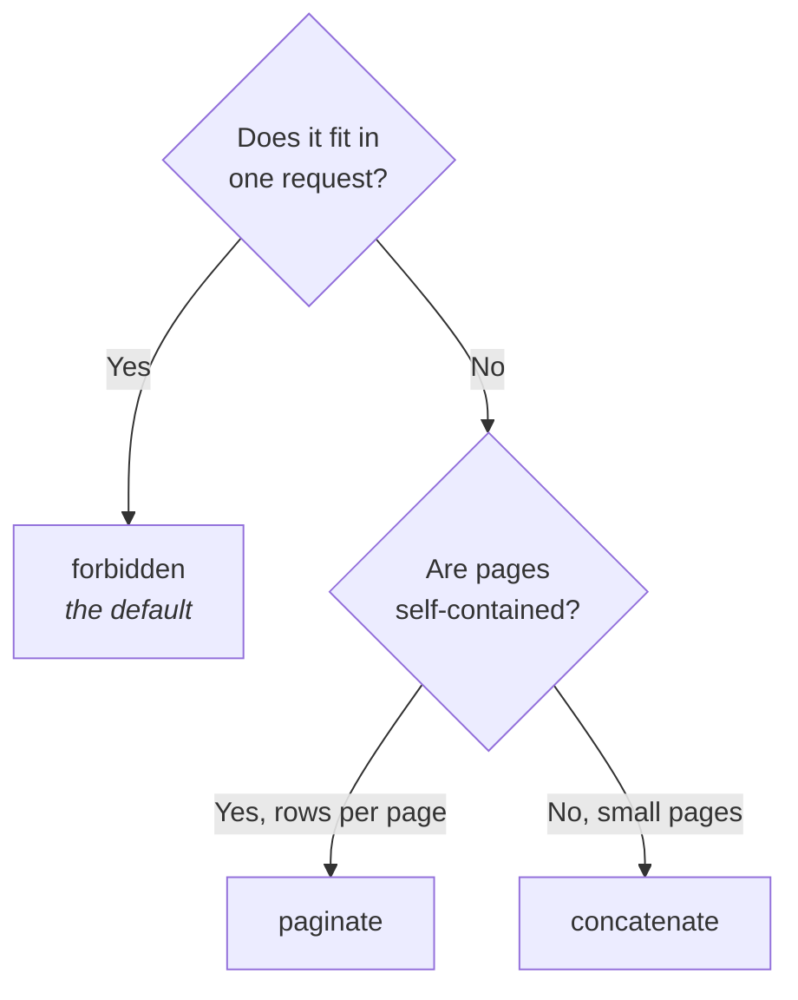

Most documents fit in one request. A 200-page statement does not. `completion` decides what
happens then.

```ts
llm({ model, completion: "paginate" });
```

| | What it does | Use when |
|---|---|---|
| `"forbidden"` *(default)* | One request, whole document | It fits. Most of the time. |
| `"paginate"` | One request per page, then merge | Pages are self-contained rows |
| `"concatenate"` | Pack pages into requests under a budget, then merge | Many small pages |



`concatenate` splits only at **page boundaries**. A table row cut in half yields two
unparseable fragments and no merge rule recovers from that, so a single page over budget is
sent whole. One oversized request that might work beats a guaranteed-broken split.

```ts
llm({ model, completion: "concatenate", maxCharsPerRequest: 24_000 });  // ~6k tokens
```

## The subtlety that makes it work

Here is the problem you would hit building this yourself.

Split a document and each request sees only **part** of it. Page 2 of an invoice genuinely
has no invoice number. That is not an error, it is the truth about page 2. But structured
output validates every response against the schema it was given, so a **strict** schema
turns that honest partial answer into a hard failure:

```
No object generated: response did not match schema.
```

The document was perfectly readable. Every field was there, somewhere.



So: **fragment requests get a schema with `required` stripped**, and only the merged result
is validated against your schema. Strictness is enforced where the whole document is in
view, which is the only place it can be enforced correctly.

Types, descriptions and nesting all survive the relaxation. The model still needs those to
produce the right shape for the fields it *did* find.

A single-request run skips all of this and uses your schema untouched, so nothing is lost
in the common case.

## The merge rules



```ts
mergePartials([
  { invoiceNumber: "INV-1", rows: [{ n: "A" }] },
  { invoiceNumber: null,    rows: [{ n: "B" }] },
]);
// { invoiceNumber: "INV-1", rows: [{ n: "A" }, { n: "B" }] }
```

**"First present wins" is the choice that matters.** The alternative, last wins, lets the
final chunk, which has the least context, overwrite good values with nulls. `null`,
`undefined` and `""` all count as absent, because that is how a model reports "not found".

## Choosing



Rough guide: at ~4 characters per token, 24,000 characters is about 6,000 tokens. Compare
your document's `text.length` against your model's practical input budget, and remember
output has its own limit, which a long `lineItems` array can hit even when the input fits.

## Watching the cost

Splitting multiplies requests, and every request re-sends the instructions:

```ts
result.usage.inputTokens;   // summed across every request
result.usage.costUsd;
result.attempts[0]?.usage;  // per attempt
```

A cache makes iteration free while you tune:

```ts
llm({ model, completion: "paginate", cache: fileCache(".docture-cache") });
```

Cache keys include whether the schema was relaxed, so a `paginate` run and a `forbidden`
run never share an entry.

## Cheaper before splitting

Splitting is not always the answer. Try in this order:

1. **Narrow the schema.** Ask for fewer fields.
2. **Limit pages.** `maxPages`, if what you need is at the front.
3. **Parse deterministically.** A known layout needs no model at all. See
   [Without a model](/docs/guides/without-a-model).
4. **Then split.**
