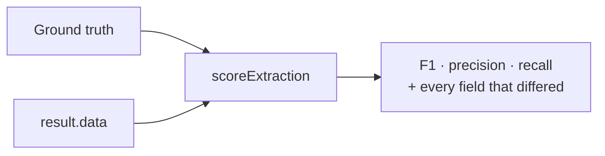
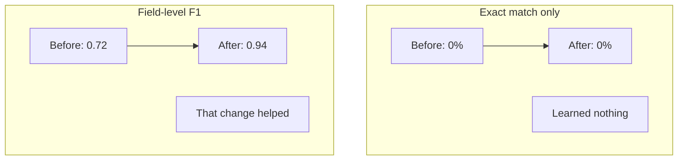
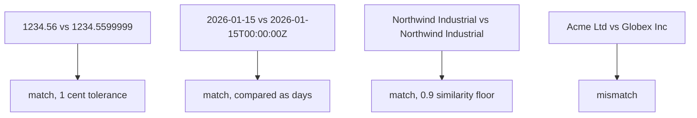
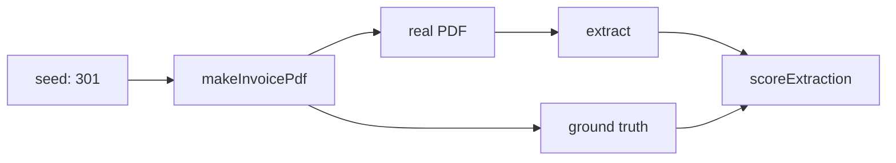

"Did that prompt change help?" is unanswerable by eye. `@docture/eval` scores an extraction
against known-correct data, **field by field**.



## Scoring one run

```ts
import { formatFailures, scoreExtraction } from "@docture/eval";

const result = await extractor.extract("invoice.pdf", Invoice);
const score = scoreExtraction(groundTruth, result.data);

score.f1;          // 0.985
score.exactMatch;  // false
console.log(formatFailures(score));
// 1 field(s) did not match:
//   omission      taxRate: expected 0.19, got undefined
```

## Why field-level, not pass/fail

Whole-document exact match is too blunt to steer by: one misread digit and every document
scores zero, which tells you nothing about whether a change helped.



`exactMatch` is still reported, as a stricter secondary signal.

## The four buckets

Every field lands in one, and the distinction matters, because a **hallucination is not a
typo**.

| | Means | Hurts |
|---|---|---|
| `match` | present in both and equal | none |
| `mismatch` | present in both, different | precision + recall |
| `omission` | truth has it, extraction does not | recall |
| `hallucination` | extraction invented it | precision |

```ts
import { hallucinations } from "@docture/eval";

hallucinations(score);  // fields that were made up, usually the ones to worry about
```

## Comparators are chosen for you

Strict equality would fail on things that are actually correct:



Tighten them when you need exactness:

```ts
scoreExtraction(truth, actual, { numericTolerance: 0, stringSimilarity: 1 });
```

## Arrays

Index-aligned by default, because for a table **document order is meaningful** and silently
reordering rows would hide a real ordering bug.

When order genuinely does not matter, align by a key:

```ts
scoreExtraction(truth, actual, { alignArraysBy: "id" });
```

## As a test

The most useful place for this is a test that fails when accuracy regresses:

```ts title="accuracy.test.ts"
import { expect, it } from "vitest";
import { makeInvoicePdf } from "@docture/testing";
import { formatFailures, scoreExtraction } from "@docture/eval";

it("extracts the invoice exactly", async () => {
  const pdf = await makeInvoicePdf({ seed: 301, lineItemCount: 5 });
  const result = await extractor.extract(pdf.bytes, Invoice);
  const score = scoreExtraction(pdf.expected, result.data);

  // Passing formatFailures as the message means a failure names the fields.
  expect(score.f1, formatFailures(score)).toBe(1);
});
```

`makeInvoicePdf` generates a real PDF **and its ground truth** from the same values, so:

- no confidential corpus is needed
- expected output cannot drift from the bytes
- `seed` makes it reproducible on every machine



## Scoring a corpus

```ts
import { aggregate, formatScoreboard, recordRun, scoreExtraction } from "@docture/eval";

const records = [];
for (const [name, pdf] of corpus) {
  const result = await extractor.extract(pdf.bytes, Invoice);
  records.push(recordRun(name, scoreExtraction(pdf.expected, result.data), result));
}

console.log(formatScoreboard(records));
```

```
| Document | F1 | Precision | Recall | Exact | Method | Miss |
| --- | --- | --- | --- | --- | --- | --- |
| invoice-302 | 1.000 | 100.0% | 100.0% | yes | invoice-parser | 0 |
| invoice-303 | 0.985 | 100.0% | 97.1% | no | llm | 1 |

**2 documents** · mean F1 0.993 · 1 exact · 1240 tokens · $0.0043 · 2180ms
```

Sorted by document name, so a diff between runs is readable in review.

```ts
const summary = aggregate(records);
summary.meanF1;
summary.byMethod;  // { "invoice-parser": 1, llm: 1 }. Was the free path used?
summary.totalCostUsd;
```

`byMethod` is the one to watch: if your deterministic parser stops winning, something about
the documents changed.

## Comparing two setups

```ts
for (const [label, extractor] of [["mini", cheap], ["full", careful]]) {
  const score = scoreExtraction(pdf.expected, (await extractor.extract(pdf.bytes, Invoice)).data);
  console.log(label, score.f1.toFixed(3));
}
```

With a `fileCache` on the strategies, re-running to compare **costs nothing** the second
time.
