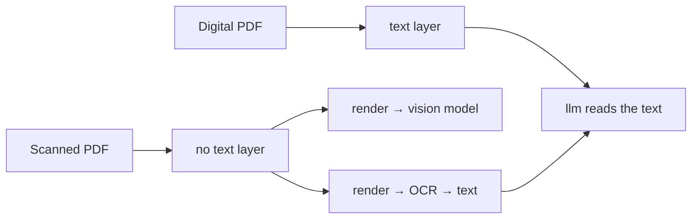
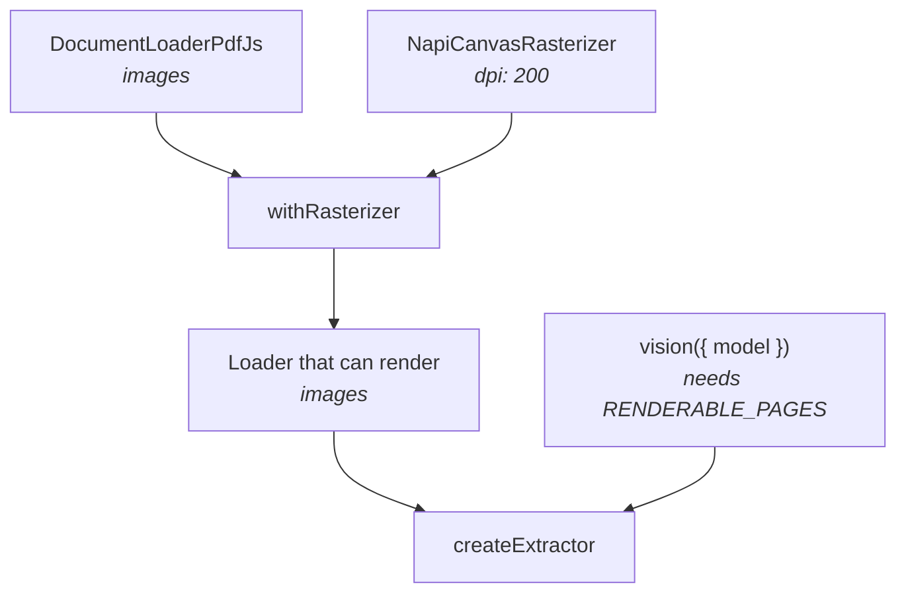
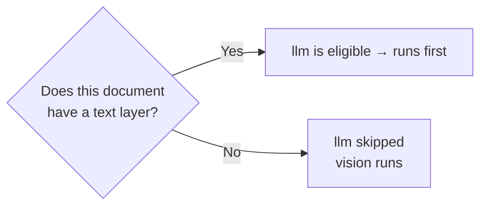
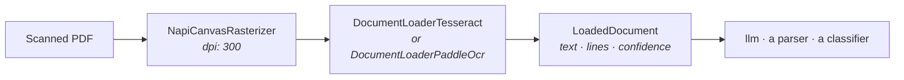
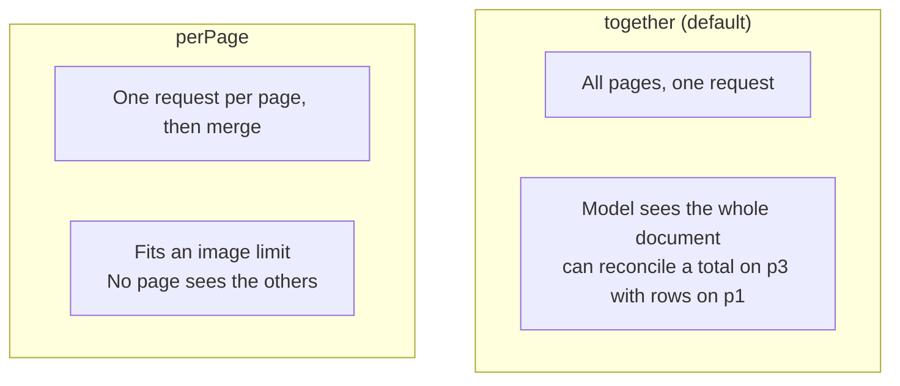

A scanned PDF is **pictures of a document**, not a document. There is no text to extract,
so a text-layer strategy is not a candidate for it. That is by design, so you get a clear error
rather than nonsense.

Two ways out, and they sit at different layers. Show the pages to a **vision model**, or
**OCR** them so the document has text after all.



## Recognising the situation

```ts
const outcome = await extractor.safeExtract("scan.pdf", Invoice);

if (!outcome.ok && outcome.error.code === "NO_ELIGIBLE_STRATEGY") {
  outcome.error.features.hasTextLayer;      // false
  outcome.error.features.hasRenderablePages; // false, nothing can render either
}
```

Or ask up front. A loader reports `form`.

```ts
document.form;  // "scanned"
```

## Fix one: render, then look

Two additions. A **rasterizer**, composed onto the loader, and a **vision strategy**.



```ts
import { createExtractor, withRasterizer } from "@docture/core";
import { DocumentLoaderPdfJs } from "@docture/loader-pdfjs";
import { NapiCanvasRasterizer } from "@docture/raster-canvas";
import { llm, vision } from "@docture/llm";
import { openai } from "@ai-sdk/openai";

const model = openai("gpt-5");

const extractor = createExtractor({
  loaders: [withRasterizer(new DocumentLoaderPdfJs(), new NapiCanvasRasterizer({ dpi: 200 }))],
  strategies: [
    llm({ model }),      // digital documents: cheaper
    vision({ model }),   // scans: the fallback
  ],
});
```

One extractor now handles both. Eligibility picks the right path per document, with no
branching in your code:



<Callout title="Use a vision-capable model">
`vision` sends images. A text-only model will reject them. Every current frontier model
handles images; check yours if it is older or specialised.
</Callout>

## Fix two: OCR, and no model at all

An OCR loader recognizes the pixels, so the scan arrives at the pipeline as a document **with
text and positions**, which means every text strategy works on it, including a deterministic
parser and a cheap text-only model.



```ts
import { createExtractor } from "@docture/core";
import { NapiCanvasRasterizer } from "@docture/raster-canvas";
import { DocumentLoaderTesseract } from "@docture/loader-tesseract";

const extractor = createExtractor({
  loaders: [new DocumentLoaderTesseract({ rasterizer: new NapiCanvasRasterizer() })],
  strategies: [llm({ model })],
});
```

Here the rasterizer is a **constructor argument** rather than a `withRasterizer` composition:
the loader cannot do its job without one, so it asks for it directly.

### Two engines, one contract

`DocumentLoaderPaddleOcr` is the same job done by a different library, and it is a drop-in swap:
both pass the same conformance suite:

```ts
import { DocumentLoaderPaddleOcr } from "@docture/loader-paddleocr";

loaders: [new DocumentLoaderPaddleOcr({ rasterizer: new NapiCanvasRasterizer() })];
```

Reach for it on **photographs, rotated or low-contrast scans, and non-Latin scripts**, where a
detect-then-recognize model holds up better than Tesseract's layout analysis. Tesseract stays
the better bet for clean scans of printed text: it is pure WASM with no native binding, and it
reports a box per **word** where PaddleOCR reports one per detected **region**, which is
coarser geometry.

The honest answer is that it depends on your documents, and you can measure it. Swap the
import and re-run [`eval`](/docs/guides/measuring-accuracy) over the same corpus. Full
comparison in [PaddleOCR or Tesseract](/docs/reference/packages#paddleocr-or-tesseract).

| | OCR | Vision |
|---|---|---|
| Cost | free after a one-off model download (about 5 to 7 MB) | per page, per token |
| Determinism | same bytes, same text | sampled |
| Gives you | text **with positions and confidence** | fields, straight from the image |
| Handwriting, stamps, bad photos | poor | much better |
| Offline | yes | no |

<Callout type="warn" title="Listing OCR after a text-layer loader is not a fallback">
Loaders are chosen by **media type**, then declaration order, then the first that does not
throw. `DocumentLoaderPdfJs` does not throw on a scan. It succeeds with `form: "scanned"`
and no text, so OCR listed after it never runs.

Either give the two loaders disjoint media types (`[new DocumentLoaderPdfJs(), new DocumentLoaderTesseract()]`
sends PDFs to the text layer and PNG/JPEG to OCR), or make "no text layer" a thrown error,
which *is* what hands the document on:

```ts
const pdfjs = new DocumentLoaderPdfJs();
const textLayerOrBust = defineLoader({
  name: pdfjs.name,
  capabilities: pdfjs.capabilities,
  async load(document, ctx) {
    const loaded = await pdfjs.load(document, ctx);
    if (loaded.form === "scanned") throw new Error("pdfjs: no text layer to read");
    return loaded;
  },
});

loaders: [textLayerOrBust, new DocumentLoaderTesseract({ rasterizer })];
```

`result.loader` and `result.attempts` then say which path each document took.
</Callout>

## Choosing a resolution

```ts
new NapiCanvasRasterizer({ dpi: 200, maxEdge: 2000, format: "jpeg", quality: 0.85 });
```

| | Why |
|---|---|
| `dpi: 200` | enough for a model to read body text; 300 is for OCR engines |
| `maxEdge: 2000` | keeps the image within a model's budget and your token cost predictable |
| `format: "jpeg"` | much smaller than PNG for a photographic scan |

`maxEdge` wins over `dpi` when they conflict. The cap exists to respect a downstream
limit.

## One request or one per page

```ts
vision({ model, pageMode: "together" });  // default
vision({ model, pageMode: "perPage" });
```



Start with `together`. Move to `perPage` when the document exceeds the model's image limit.

Under `perPage` each request gets a **relaxed schema** (required fields dropped) and only
the merged result is validated strictly. Otherwise a page that legitimately has no invoice
number would be a hard failure. See [Long documents](/docs/guides/long-documents).

## Limiting pages

A 60-page scan is expensive. If the fields you want are on the first two pages:

```ts
vision({ model, maxPages: 2 });
```

## Rendering costs only what you use

Page images are lazy and memoized, so `vision({ maxPages: 2 })` on a 200-page document
renders **two pages**.

```ts
new DocumentLoaderPdfJs().capabilities.images;  // false, reading is free
// Rendering happens only when a strategy calls page.image()
```

## Mixed documents

A digital invoice with a scanned annex reports `form: "mixed"`. Both strategies are
eligible, `llm` runs first, and if it cannot find what your schema needs, validation fails
and `vision` gets a turn, which is exactly the behaviour you want.

<Cards>
  <Card title="Rasterizers" href="/docs/concepts/rasterizers" description="Rendering options in full." />
  <Card title="Long documents" href="/docs/guides/long-documents" description="Splitting and merging." />
</Cards>
