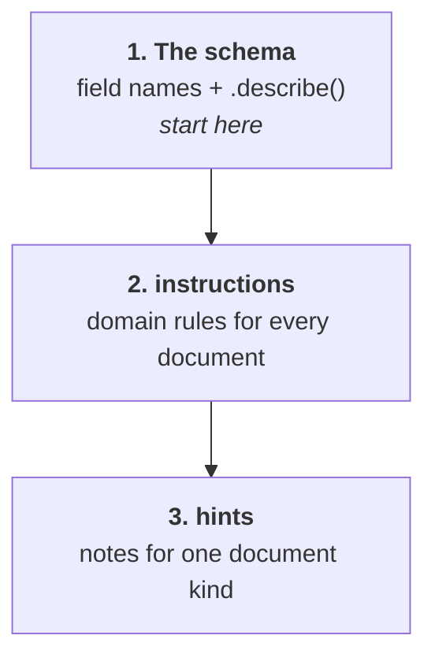
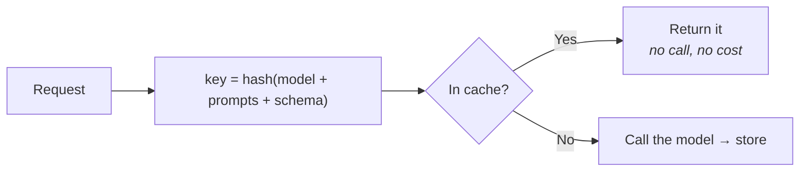

## The model is the AI SDK's model

docture does not wrap providers or keep a model registry. You pass an AI SDK
`LanguageModel` and that is the integration:

```ts
import { llm } from "@docture/llm";
import { openai } from "@ai-sdk/openai";
import { anthropic } from "@ai-sdk/anthropic";

llm({ model: openai("gpt-5") })
llm({ model: anthropic("claude-opus-5") })
llm({ model: "openai/gpt-5" })   // AI Gateway, no provider package needed
```

`ai` is a **peer dependency**, so there is exactly one copy of the model types in your
tree and the model you construct is the model that runs.

## The short form

```ts
import { Extractor, LLM } from "docture";
import { DocumentLoaderPdfJs } from "@docture/loader-pdfjs";

const extractor = new Extractor()
  .loadDocumentLoader(new DocumentLoaderPdfJs())
  .loadLlm(new LLM(openai("gpt-5")));
```

`loadLlm` takes a `ModelBackend`, not a `LanguageModel`, because `@docture/core` does not
depend on the AI SDK and an architecture test enforces it. `LLM` is that backend. it knows how to turn one model into the extraction strategy, the vision
strategy, the classifier and the splitter, all configured once.

```ts
.loadLlm(new LLM(openai("gpt-5"), { pricing, cache, instructions }), {
  vision: true,    // also register VisionStrategy, for documents with no text layer
  classify: true,  // also register LlmClassifier
})
```

A backend with no vision refuses `{ vision: true }` at that line, naming itself, rather
than failing on the first scanned page.

Everything below still works through `loadStrategy(llm({ … }))` if you would rather
build the strategy yourself, and `new Extractor({ loaders, strategies })` /
`createExtractor(...)` take the same wiring as one object.

## Guiding the model

Three levers, in increasing specificity.



```ts
llm({
  model: openai("gpt-5"),
  instructions: [
    "Amounts are in EUR unless the document says otherwise.",
    "A parenthesised figure is negative.",
  ].join("\n"),
  hints: {
    invoice: "The total is the bottom-right figure, after any VAT line.",
    receipt: "There is no invoice number; leave it null.",
  },
});
```

`hints` are keyed by classification name, so they only apply when that kind was decided.

The built-in system prompt already covers the basics: use only what the document says,
never invent, ISO dates, plain numbers, preserve row order. Add to it with `instructions`;
replace it entirely with `system` only if you really mean to.

## Determinism

`temperature` defaults to **0**, because extraction should give the same answer twice. Do
not raise it. A document has one correct reading.

## Cost

Token counts come from the provider. Prices do not, so you supply them:

```ts
llm({
  model: openai("gpt-5"),
  pricing: { "gpt-5": { inputPerMillion: 2, outputPerMillion: 10 } },
});

result.usage.costUsd;  // 0.0043
```

Without a pricing table, `costUsd` is `undefined` rather than `0`, because `0` would
read as "this was free". It was not; we just do not know the price.

Keyed by model id, and a table keyed `"gpt-5"` also prices a gateway string of
`"openai/gpt-5"`.

## Caching

```ts
import { fileCache, memoryCache } from "@docture/llm";

llm({ model: openai("gpt-5"), cache: fileCache(".docture-cache") });
```

The key covers the model id, both prompts, and the JSON Schema, so changing your
schema can never be served an old shape.



Worth it for two things: re-running an eval over the same corpus, and making a test suite
replayable offline.

## Putting a cheap model in front

```ts
new Extractor().loadDocumentLoader(new DocumentLoaderPdfJs()).loadStrategy(
  llm({ model: openai("gpt-5-mini"), name: "cheap" }),
  llm({ model: openai("gpt-5"), name: "careful" }),
);
```

Or, if each model carries its own configuration:

```ts
new Extractor()
  .loadDocumentLoader(new DocumentLoaderPdfJs())
  .loadLlm(new LLM(openai("gpt-5-mini"), { extraction: { name: "cheap" } }))
  .loadLlm(new LLM(openai("gpt-5"), { extraction: { name: "careful" } }));
```

The cheap model goes first. If its answer fails your schema, the careful one gets a turn, and
and `result.method` tells you which paid off. Tighten the schema (`.min()`, `.regex()`) to
make the first pass fail loudly rather than quietly returning something plausible.

## Cancelling

```ts
const controller = new AbortController();
setTimeout(() => controller.abort(), 30_000);

await extractor.extract("invoice.pdf", Invoice, { signal: controller.signal });
```

A caller abort stops the run. It does not fall through to the next strategy, because
you asked it to stop. An internal per-stage deadline (`stageTimeoutMs`) is different: that
is a failure of that strategy, and the next one still gets a turn.

## Batches

```ts
for await (const item of extractor.extractBatch(files, Invoice, { concurrency: 4 })) {
  if (item.outcome.ok) save(item.outcome.result.data);
  else console.error(files[item.index], item.outcome.error.message);
}
```

Results arrive as they finish, and it never rejects. One bad scan in a batch of 500
does not lose the other 499.
