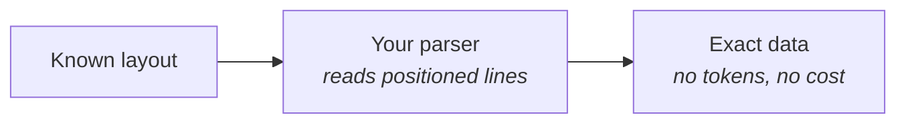
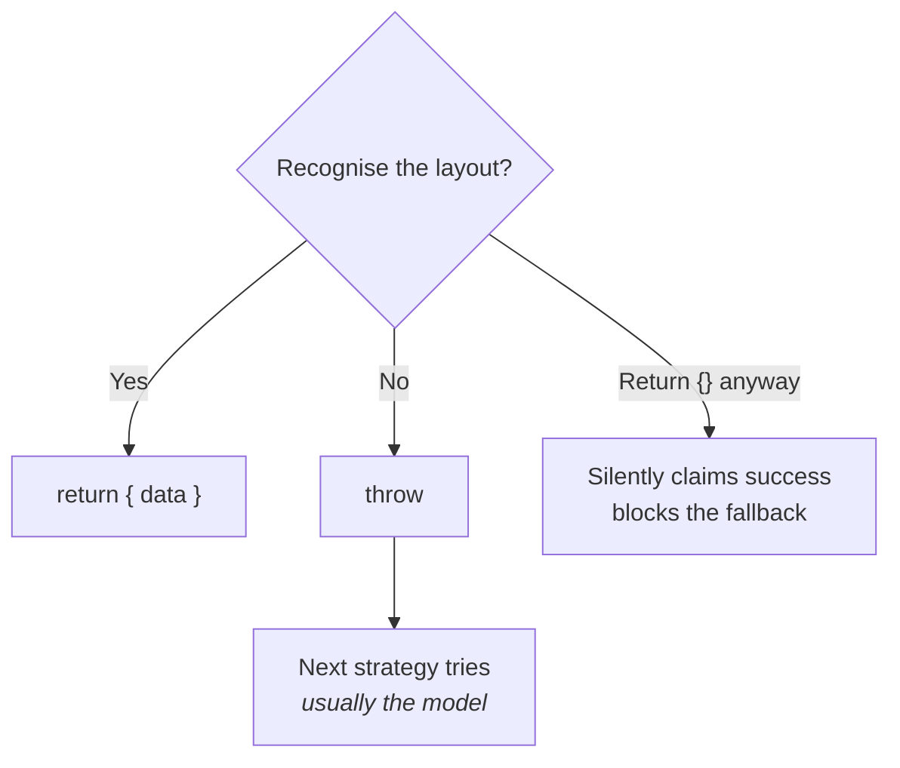

If you process the same layout over and over, a model is the expensive way to do it. A
deterministic parser over the loader's positioned lines is **free, exact, and instant**.



This guide builds one end to end. It is the same parser used in the repo's golden-path
test, which scores **F1 1.0** on a 45-row multi-page invoice with no model involved.

## What the loader gives you

A geometry-capable loader groups each visual row into one line, so a table row arrives as
one string with its cells in order:

```
INVOICE
Invoice Number: INV-2026-4287
Issue Date: 2026-02-18
Description Qty Unit Price Amount
Hydraulic coupling #100 12 149.05 1,788.60
Sealing ring set #101 2 146.67 293.34
Subtotal 7,341.15
VAT 19% 1,394.82
TOTAL (EUR) 8,735.97
```

That is what makes a deterministic parser practical: you match against **rows**, not a
soup of words.

## The parser

```ts title="invoice-parser.ts"
import { defineStrategy, type LoadedDocument } from "@docture/core";

function allLines(document: LoadedDocument): string[] {
  return document.pages.flatMap((page) => (page.lines ?? []).map((line) => line.text));
}

/** "1,234.56" → 1234.56 */
function parseMoney(text: string): number {
  return Number(text.replace(/,/g, ""));
}

export const invoiceParser = defineStrategy({
  name: "invoice-parser",
  requires: ["TEXT_LAYER", "GEOMETRY"],

  async extract(ctx) {
    const lines = allLines(ctx.document);

    const after = (label: string) =>
      lines.find((l) => l.startsWith(label))?.slice(label.length).trim();

    const invoiceNumber = after("Invoice Number:");

    // Not our layout. Throw, so the next strategy gets a turn.
    if (invoiceNumber === undefined) {
      throw new Error("no 'Invoice Number:' line, so this is not an invoice we can read");
    }

    // A totals row ends with the amount.
    const totalsRow = (label: string) => {
      const amount = lines.find((l) => l.startsWith(label))?.match(/([\d,]+\.\d{2})\s*$/)?.[1];
      return amount === undefined ? undefined : parseMoney(amount);
    };

    // A line item row: description … qty unitPrice amount
    const rowPattern = /^(.*?#\d+)\s+(\d+)\s+([\d,]+\.\d{2})\s+([\d,]+\.\d{2})$/;
    const lineItems = lines
      .map((line) => rowPattern.exec(line))
      .filter((m): m is RegExpExecArray => m !== null)
      .map((m) => ({
        description: m[1]!.trim(),
        quantity: Number(m[2]),
        unitPrice: parseMoney(m[3]!),
        amount: parseMoney(m[4]!),
      }));

    return {
      data: {
        invoiceNumber,
        issuedAt: after("Issue Date:"),
        total: totalsRow("TOTAL ("),
        subtotal: totalsRow("Subtotal"),
        tax: totalsRow("VAT"),
        lineItems,
      },
    };
  },
});
```

## Wire it

```ts
const extractor = createExtractor({
  loaders: [new DocumentLoaderPdfJs()],
  strategies: [invoiceParser],
});

const result = await extractor.extract("invoice.pdf", Invoice);

result.method;             // "invoice-parser"
result.usage.totalTokens;  // 0
result.usage.costUsd;      // undefined, nothing was spent
```

## The rule that makes it composable

**Throw when you cannot do the job.** Never return a half-filled object.



That one rule is what lets you combine the two approaches:

```ts
createExtractor({
  loaders: [new DocumentLoaderPdfJs()],
  strategies: [
    invoiceParser,                    // free and exact, for layouts you know
    llm({ model: openai("gpt-5") }),  // the safety net for everything else
  ],
});
```

Known layouts cost nothing. New ones still work. `result.method` tells you which happened,
and `result.attempts` tells you why.

## Debugging a parser

Print the lines your parser actually sees:

```ts
const loader = new DocumentLoaderPdfJs();
const document = await loader.load(
  { bytes: await readFile("invoice.pdf"), mimeType: "application/pdf" },
  { signal: new AbortController().signal, logger: consoleLogger() },
);

for (const page of document.pages) {
  console.log(`--- page ${page.pageNumber} ---`);
  for (const line of page.lines ?? []) {
    console.log(`y=${line.y.toFixed(0).padStart(4)}  ${line.text}`);
  }
}
```

If a row you expected is split across two lines, widen the grouping band:

```ts
new DocumentLoaderPdfJs({ lineTolerance: 0.8 });  // default 0.5
```

## Position when text is not enough

Two columns can produce the same words in a different order. Use the spans' `x`:

```ts
const cellsRightOf = (line: TextLine, x: number) =>
  line.spans.filter((span) => span.x > x).map((span) => span.text);
```

Coordinates are PDF points, top-left origin. See
[Loaders](/docs/concepts/loaders#coordinates).

<Cards>
  <Card title="Measuring accuracy" href="/docs/guides/measuring-accuracy" description="Prove the parser is right, and keep it right." />
  <Card title="Strategies" href="/docs/concepts/strategies" description="The contract in full." />
</Cards>
