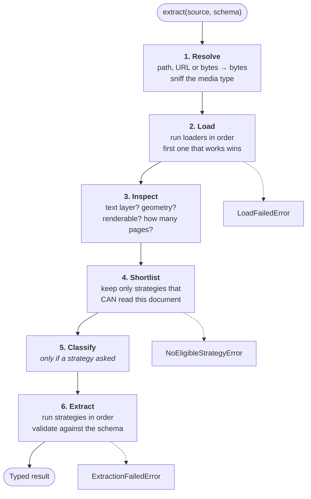
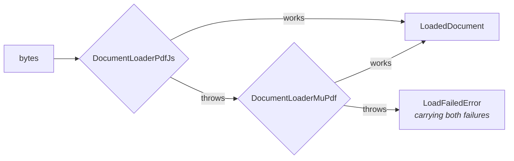
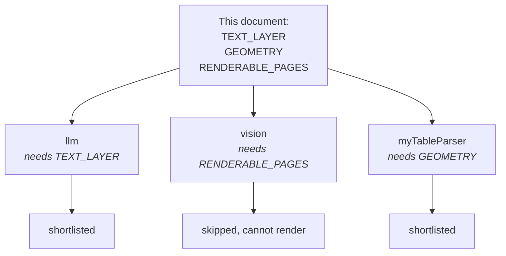
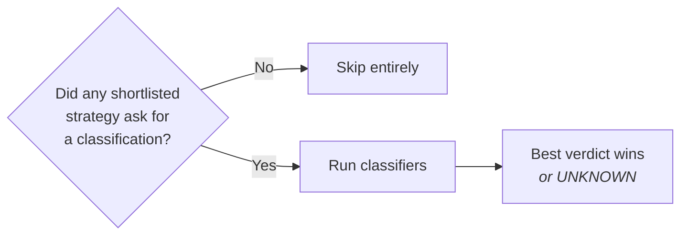
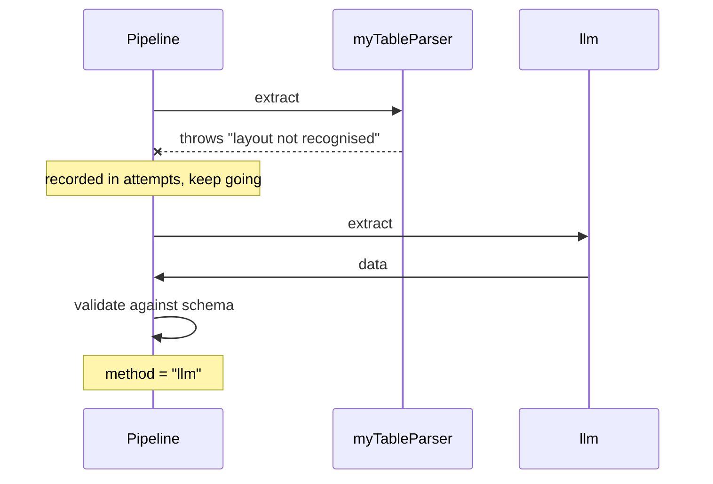
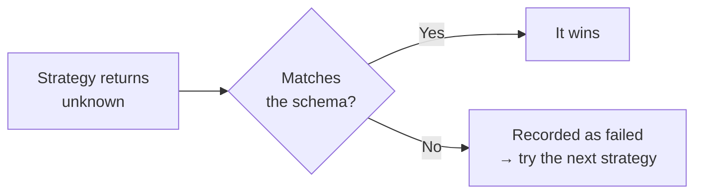
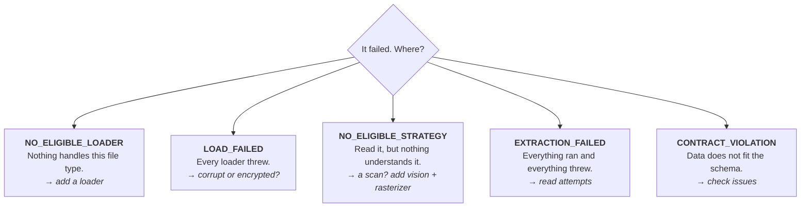

`extract()` runs six steps. Each one can stop the run with a **named** error, so when
something goes wrong you are told which step and why.



## 1. Resolve the source

Pass whatever you have. A path, a URL, or raw bytes.

```ts
await extractor.extract("./invoice.pdf", Invoice);
await extractor.extract(new URL("https://example.com/invoice.pdf"), Invoice);
await extractor.extract(bytes, Invoice);
```

The media type comes from the magic bytes first, then the file extension. A mislabelled
file is common. A mislabelled header is not.

## 2. Load

Loaders are tried in the order you listed them. The first one that accepts the media type
and does not throw wins.



A `LoadedDocument` is pages. Each page has text, and lines with positions when the loader
can produce them.

```ts
{
  pages: [{ pageNumber: 1, width: 595, height: 842, text: "…", lines: [ … ] }],
  text: "…",             // whole document, pages joined
  form: "digital",       // or "scanned" | "mixed"
  loader: "pdfjs",
}
```

## 3. Inspect what was actually found

Not what the loader *claims* it can do. What this document actually has.

| Fact | True when |
|---|---|
| `TEXT_LAYER` | the document carries real text (≥ 50 characters) |
| `GEOMETRY` | positioned line and word boxes are available |
| `RENDERABLE_PAGES` | pages can be turned into images |

## 4. Shortlist the strategies

Each strategy declares what it needs. A strategy whose needs are not met **never runs**.



If the shortlist is empty you get `NoEligibleStrategyError`, and it tells you the
document's facts, so you can see whether you need a rasterizer or the file was a scan.

<Callout>
This is why a scanned PDF does not produce garbage. A text-layer strategy is simply not a
candidate for a document with no text.
</Callout>

## 5. Classify, only if asked

Classification runs **only when a shortlisted strategy wants it**. No strategy asked, no
model call, no wasted work.



## 6. Extract

Strategies run in your declared order. The first that returns data **passing your schema**
wins.



Every attempt is recorded, whether it won or failed:

```ts
result.method;    // "llm", who answered
result.attempts;  // [{ strategy: "myTableParser", status: "failed", error: "…" },
                  //  { strategy: "llm", status: "ok", ms: 1840 }]
```

So "why did the model run when my parser should have handled it?" is answerable from the
return value. **A fallback is never silent.**

### Validation happens in exactly one place

A strategy returns raw data. The **pipeline** validates it against your schema.



Two consequences worth knowing:

1. **A wrong shape is recoverable.** A strategy that produces the wrong thing is a failed
   attempt, not a dead run. The next strategy still gets a turn.
2. **`validation` means one thing.** It cannot differ depending on who answered.

## Errors, and what each one tells you



The first three are **wiring** problems; the last two are about this document. Full list
in [Errors](/docs/reference/errors).

## Not throwing

`safeExtract` is the same run without the throw, the same pairing as Zod's
`parse` / `safeParse`.

```ts
const outcome = await extractor.safeExtract("invoice.pdf", Invoice);

if (outcome.ok) outcome.result.data.total;
else            console.error(outcome.error.code);
```
