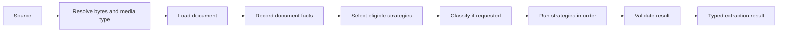

`extract()` resolves the input, loads it, records document facts, selects strategies,
and validates their results.



## Resolve the source

The source may be a path, URL, byte array, raw document, or loaded document.

```ts
await extractor.extract("invoice.pdf", Invoice);
await extractor.extract(new URL("https://example.com/invoice.pdf"), Invoice);
await extractor.extract(bytes, Invoice);
await extractor.extract({ bytes, mimeType: "application/pdf" }, Invoice);
await extractor.extract({ loaded: document }, Invoice);
```

For files and byte arrays, docture checks magic bytes before file extensions. An HTTP
failure, empty input, or unsupported URL protocol raises `UnsupportedSourceError`.

## Load the document

docture filters loaders by media type, then tries them in declaration order. The first
loader that returns a document wins.

If no loader accepts the media type, docture raises `NoEligibleLoaderError`. If eligible
loaders run and all throw, it raises `LoadFailedError` with the loader attempts.

A successful extraction records only the winning loader in `result.loader`.

## Record document facts

Routing uses facts found on the loaded document:

| Fact | Condition |
|---|---|
| `TEXT_LAYER` | The document contains at least `MIN_TEXT_LAYER_CHARS` trimmed characters |
| `GEOMETRY` | Positioned lines are present |
| `RENDERABLE_PAGES` | Loaded pages have an `image()` function |

`features.form` is `digital`, `scanned`, `mixed`, or `unknown`. Custom loaders may add
facts through `features.extra`.

Capabilities such as `GeometryLoader` are useful compile-time types when an API asks for
one. Strategy requirements are different. The pipeline checks `requires` against the
loaded document at runtime.

## Select strategies

Each strategy may list document facts in `requires`. A strategy missing any required fact
does not run.

```ts
const parser = defineStrategy({
  name: "invoice-parser",
  requires: ["TEXT_LAYER", "GEOMETRY"],
  async extract(ctx) {
    return { data: parseInvoice(ctx.document) };
  },
});
```

If no strategy is eligible, docture raises `NoEligibleStrategyError`. The error includes
the document features and one gap for each rejected strategy.

The routing policy receives eligible strategies only. The default policy preserves
declaration order.

## Classify when requested

Classification runs when an eligible strategy sets `needsClassification` to `hint` or
`required`. A classifier returns a signal or `null` to abstain. The pipeline records a
thrown classifier as an abstention so another classifier can still answer.

A strategy that requires classification does not run when the result is `UNKNOWN`.

## Extract and validate

Strategies run in policy order. A strategy can throw to let the next strategy try.

Returning data is not enough to win. The pipeline validates the data against the caller's
schema. Invalid data becomes a failed attempt, then the next strategy runs.

If no strategy succeeds and at least one returned invalid data, docture raises the first
`ContractViolationError`. If every strategy threw before validation, it raises
`ExtractionFailedError`.

## Cancellation and deadlines

A caller abort stops the whole run and suppresses fallback. A stage deadline creates a
`TimeoutError` for that stage, records the failed attempt, and allows fallback.

```ts
const controller = new AbortController();

await extractor.extract("invoice.pdf", Invoice, {
  signal: controller.signal,
  stageTimeoutMs: 30_000,
});
```

See [errors](/docs/reference/errors) for the full error contract and
[routing and fallback](/docs/guides/routing-and-fallback) for configuration examples.
