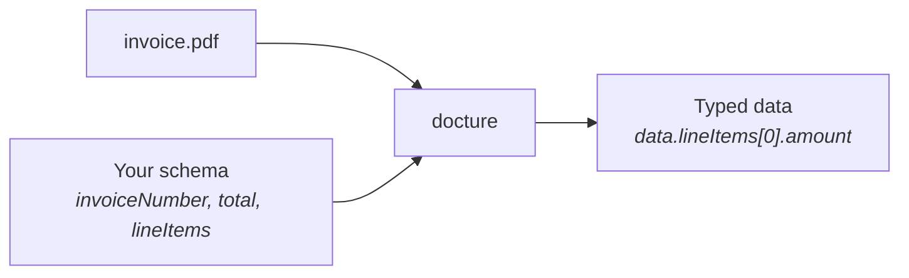
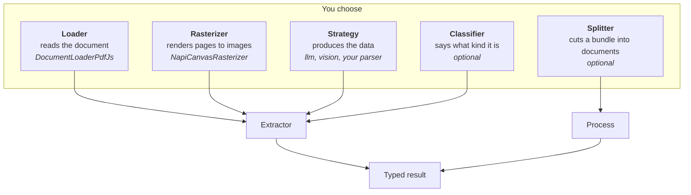

docture turns a document into structured data that TypeScript knows the shape of.

You describe what you want with a schema. It reads the document, fills the schema, and
hands it back typed to the leaves.



That is the whole job. Everything else in these docs is about *how* it reads the
document, and about letting you choose.

## The shortest real example

```ts
import { Extractor, LLM, contract } from "docture";
import { DocumentLoaderPdfJs } from "@docture/loader-pdfjs";
import { openai } from "@ai-sdk/openai";
import { z } from "zod";

const Invoice = contract({
  name: "invoice",
  description: "A commercial invoice with a total and line items.",
  schema: z.object({
    invoiceNumber: z.string(),
    total: z.number(),
    lineItems: z.array(z.object({ description: z.string(), amount: z.number() })),
  }),
});

const extractor = new Extractor()
  .loadDocumentLoader(new DocumentLoaderPdfJs())   // how to READ the document
  .loadLlm(new LLM(openai("gpt-5")));              // how to UNDERSTAND it

const result = await extractor.extract("invoice.pdf", Invoice);

result.data.lineItems[0].amount;  // number, inferred from the contract
```

Three things to notice, because they are the shape of the whole library.

**A loader reads. A strategy understands.** They are separate, and you pick both.

**`result.data` is typed.** Not `any`, not `unknown`. The actual shape of your schema.

**`result` is an envelope, not the fields.** It carries which strategy answered, every
attempt with its error, and what it cost. `extractData` gives you the fields alone.

## The five pieces

Everything you wire together is one of five kinds of thing.



| | Answers | Example |
|---|---|---|
| Loader | "What text and boxes are on these pages?" | `DocumentLoaderPdfJs` |
| Rasterizer | "What do these pages look like?" | `NapiCanvasRasterizer` |
| Strategy | "What is the data?" | `LLM(…).extraction()`, `llm(…)`, your own parser |
| Classifier | "Is this an invoice or a receipt?" | `LlmClassifier(…)` |
| Splitter | "Where does one document end and the next begin?" | `ImageSplitter`, `TextSplitter` |

Each is a plain object you can write yourself. There is no base class to extend.

## Why not just call a model directly?

You could. Here is what you would then build yourself, and what docture already handles.

- Getting text with positions out of a PDF, and telling a scan from a digital file.
- Falling back when one approach fails, and being able to see that it happened.
- One scan that is really eleven documents, cut up and extracted separately.
- Documents too long for one request, split and merged without losing fields.
- Scans, which need rendering to images before a model can read them.
- Validating the answer against your schema, in one place, whatever produced it.
- Knowing what it cost.

## Where to go next

<Cards>
  <Card title="Quick start" href="/docs/quick-start" description="Running in about five minutes." />
  <Card title="How it works" href="/docs/how-it-works" description="The pipeline, step by step, with diagrams." />
  <Card title="Loaders" href="/docs/concepts/loaders" description="Choosing how the document gets read." />
  <Card title="Without a model" href="/docs/guides/without-a-model" description="Deterministic extraction, no API calls." />
</Cards>
