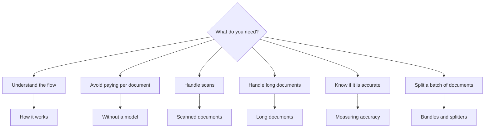

## 1. Install

You always need **core**, **a loader**, and **a way to understand the document**.

```package-install
docture @docture/loader-pdfjs ai @ai-sdk/openai zod
```

<Callout title="Why two docture packages?">
`docture` is a facade: it re-exports `@docture/core` and `@docture/llm` so the pipeline,
the contracts and the model arrive in one import. Loaders stay separate because they are
the heavy dependencies. Installing `core` alone pulls no PDF parser, no WASM and no
ONNX. See [Packages](/docs/reference/packages).
</Callout>

## 2. Describe what you want

A **contract** is a schema that knows its own name. Field names guide the model;
`.describe()` helps it when a name is not obvious; the contract's `name` and
`description` are prompt material too.

```ts title="invoice.ts"
import { contract } from "docture";
import { z } from "zod";

export const Invoice = contract({
  name: "invoice",
  description: "A commercial invoice with a total and line items.",
  schema: z.object({
    invoiceNumber: z.string().describe("The invoice number, usually top-right"),
    issuedAt: z.string().describe("Issue date, ISO 8601"),
    total: z.number(),
    lineItems: z.array(
      z.object({
        description: z.string(),
        quantity: z.number(),
        amount: z.number(),
      }),
    ),
  }),
});
```

The wrapper is optional. Every call that takes a contract also takes a bare schema, so
`z.object({ … })` on its own works exactly the same. Name it when something reads the
name. See [Contracts](/docs/concepts/contracts).

Zod is the default in these docs, but Valibot, ArkType and plain JSON Schema all work.
See [Schemas and types](/docs/concepts/schemas-and-types).

## 3. Extract

```ts title="extract.ts"
import { Extractor, LLM } from "docture";
import { DocumentLoaderPdfJs } from "@docture/loader-pdfjs";
import { openai } from "@ai-sdk/openai";
import { Invoice } from "./invoice.js";

const extractor = new Extractor()
  .loadDocumentLoader(new DocumentLoaderPdfJs())
  .loadLlm(new LLM(openai("gpt-5")));

try {
  const result = await extractor.extract("./invoice.pdf", Invoice);

  console.log(result.data.invoiceNumber);       // string
  console.log(result.data.lineItems[0]?.amount); // number | undefined
  console.log(result.method, result.usage.costUsd);
} finally {
  // Releases loaders, engines and workers. Once, and safe to call twice.
  await extractor.dispose();
}
```

```sh
OPENAI_API_KEY=sk-… npx tsx extract.ts
```

That is a working extractor.

<Callout title="One object instead of a chain">
`new Extractor({ loaders: [...], strategies: [...] })` builds exactly the same thing, and
so does `createExtractor(...)`. Wiring can come from a config file rather than a chain of
calls.
</Callout>

## 4. Understand what came back

```ts
result.data;        // your schema's type, validated
result.method;      // which strategy answered, "llm"
result.loader;      // which loader read it, "pdfjs"
result.attempts;    // every strategy tried, in order, with errors
result.features;    // what the document turned out to have
result.usage;       // tokens, cost, wall time
result.validation;  // { valid, issues }
```

`result.data` is typed from the contract, so your editor autocompletes every field and a
typo is a compile error.

When the envelope is more than you need, `extractData` returns just the fields:

```ts
const invoice = await extractor.extractData("./invoice.pdf", Invoice);
invoice.total;   // number
```

And `safeExtract` returns a discriminated union instead of throwing, mirroring Zod's
`parse` / `safeParse` pairing.

## Where to go from here



<Cards>
  <Card title="How it works" href="/docs/how-it-works" description="The six steps, with diagrams." />
  <Card title="Without a model" href="/docs/guides/without-a-model" description="Deterministic parsing, zero API cost." />
  <Card title="Scanned documents" href="/docs/guides/scanned-documents" description="Rendering pages for a vision model." />
  <Card title="Long documents" href="/docs/guides/long-documents" description="When one request is not enough." />
  <Card title="Bundles and splitters" href="/docs/concepts/bundles-and-splitters" description="One scan, eleven documents." />
</Cards>

## Or read a working one

`apps/examples` in the repo is a tour of the library, one folder per concept, on a corpus
of real documents downloaded off the web: eleven invoices in eleven layouts, one that
arrives as plain text, two page rasters with no text layer, and a six-page bank statement
holding two accounts.

```sh
pnpm --filter @docture/examples fetch
pnpm --filter @docture/examples quick-start
pnpm --filter @docture/examples offline      # the eleven that need no API key
```

No API key for most of it. `01-quick-start` runs on a deterministic parser reading the real
text layer; `12-accuracy-and-batch` scores itself against ground truth published beside the
PDFs, and reconciles the statement's 48 transactions against its closing balance.
