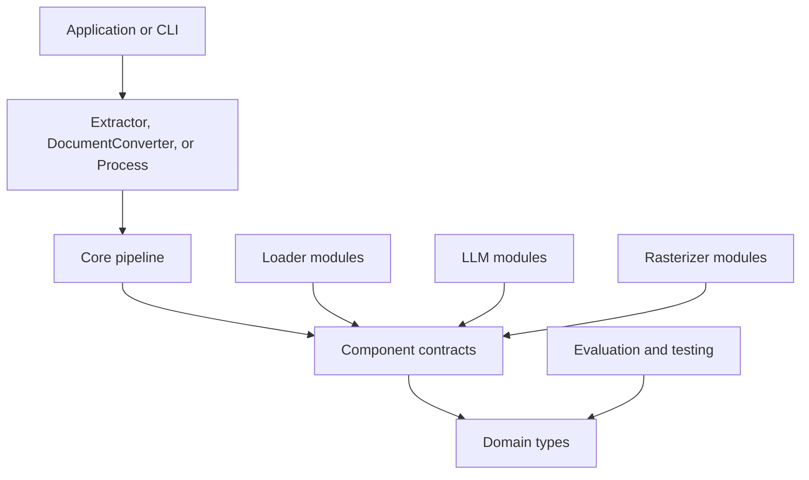

Docture separates document data, component contracts, pipeline control flow, and
composition inside `packages/docture/src`. Adapter modules depend on core, while core does not depend on a document
parser or model runtime.

## Core layers

| Layer | Responsibility |
| --- | --- |
| `domain` | Sources, loaded pages, semantic layout, document facts, contracts, results, usage, and split groups. |
| `contracts` | Loader, rasterizer, strategy, classifier, splitter, layout analyzer, model, and extractor interfaces. |
| `pipeline` | Source resolution, loading, feature inspection, classification, routing, attempts, validation, deadlines, and errors. |
| `Extractor` | Component registration, defaults, batches, classification entry points, and disposal. |
| `DocumentConverter` | Shared loading, deterministic layout analysis, text-format export, batches, and disposal. |
| `Process` | Load-once bundle splitting and extraction by classification. |

`DocumentLoaderData` is the only loader in core because it uses `TextDecoder` and no
third-party document library.

## Extension boundaries

A loader converts a `RawDocument` into a `LoadedDocument`. It may expose text, geometry,
and page image functions.

A rasterizer converts a raw document into page images. `withRasterizer()` composes it
with a loader and adds renderable pages without changing either component.

A strategy receives a loaded document and resolved schema, then returns unvalidated data.
Core owns validation and fallback.

A classifier returns one signal or abstains. Core reconciles signals and chooses the
verdict.

A splitter judges page seams. Core owns the fold from seam verdicts to complete page
groups.

`ModelBackend` lets core accept a model-backed component without importing the AI SDK.
`DocumentExtractor` lets classifications refer to an extractor without depending on the
concrete `Extractor` class.

`LayoutAnalyzer` is the optional assistance boundary for conversion. Its annotations
contain existing element IDs, roles, grouping, and order, but no text. Core validates the
IDs and ordering before applying them, so the analyzer cannot add, remove, or rewrite
source text.

## Data flow

For a normal extraction, core resolves the source, tries eligible loaders in order,
computes facts from the loaded document, and finds eligible strategies. Classification
runs only when an eligible strategy requests it. The routing policy orders the remaining
strategies.

Each strategy returns data or throws. Core validates returned data. Invalid data is a
failed attempt, so the next strategy can run. The first validated result becomes the
`ExtractionResult`.

For a bundle, `Process` loads once, splits the in-memory pages, and passes each page group
back to an extractor as a `LoadedSource`. Original page numbers remain intact.

For conversion, core uses the same source resolution and first-success loader routing.
The loader receives optional requests for layout and asset data. Deterministic analysis
turns the loaded blocks into semantic elements, optional validated annotations refine
their roles and order, and the exporter produces TXT, Markdown, or HTML in memory.

## Tested invariants

The test suites enforce these behaviors:

1. Domain and contract layers do not import higher layers.
2. Importing `docture` does not load a document parser, OCR engine, canvas, ONNX
   Runtime, or the AI SDK runtime.
3. Duplicate component names fail during registration.
4. Eligibility is based on facts computed from the loaded document.
5. Classification runs only when an eligible strategy needs it.
6. A strategy wins only after its data passes schema validation.
7. Strategy attempts are recorded in run order. Failed loaders remain visible when loader
   fallback succeeds, and all loader failures are attached to `LoadFailedError` otherwise.
8. Caller aborts stop fallback. Library deadlines allow fallback.
9. Classifier failures become abstentions unless they are caller aborts.
10. Split groups preserve every page, and unknown groups fail unless the caller chooses to
    skip them.
11. `Extractor.dispose()` is idempotent and reports all disposal failures.
12. The root exports core only. Public subpaths expose model, adapter, evaluation, and testing modules.
13. Conversion assistance cannot carry text or reference unknown element IDs.

Loader and rasterizer modules run shared conformance suites. Type tests cover generic
inference and APIs that explicitly require capability-specific loader types. Generated
fixtures keep test bytes and expected values in the same source.
