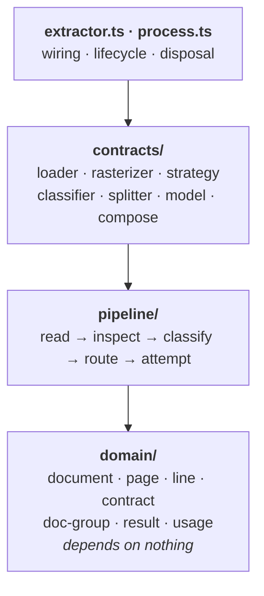
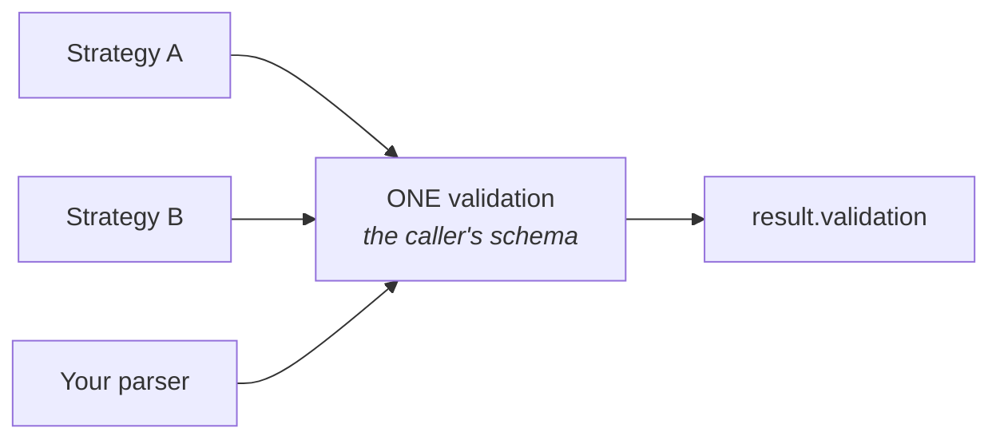
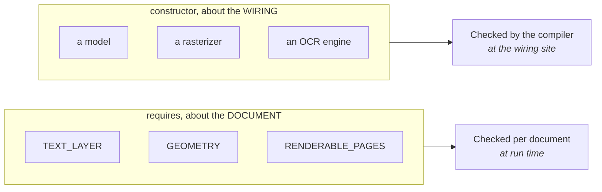

## Layers

Dependencies point downward only.

| Layer | Owns | Change it when |
|---|---|---|
| `domain/` | the vocabulary, the closed enums, and the shared word-to-line grouper | the vocabulary changes |
| `pipeline/` | control flow, schema resolution, the load stage, deadlines, typed failures | orchestration changes |
| `contracts/` | the plugin interfaces, plus `withRasterizer` | an interface changes shape |
| `extractor.ts` | which components exist and who disposes them | the default wiring changes |
| `process.ts` | reading a bundle once, cutting it, routing each document | multi-document handling changes |

One loader lives in core, `DocumentLoaderData`, because it wraps no library. Plain text,
Markdown, CSV and JSON are bytes plus a `TextDecoder`.

This is not a convention. `packages/core/test/architecture.test.ts` walks the import graph
and fails the build if an edge points the wrong way.

## Two interfaces exist to keep the AI SDK out of core

A deterministic pipeline should not install a model client, and a test enforces that core
imports nothing but `@ai-sdk/provider-utils`. Both of these exist because of it.

`contracts/model.ts` declares `ModelBackend`. `extractor.loadLlm(...)` takes one, so core
accepts a model without importing one. `@docture/llm`'s `LLM` class is the implementation.

`contracts/extractor.ts` declares `DocumentExtractor`, above the class that implements it,
so a `Classification` can carry its own extractor without `contracts/` depending on the
composition root.

## Decisions worth knowing

### Strategies do not validate

A strategy returns `data: unknown`. The pipeline validates it once against your schema.

So `validation` cannot mean two different things depending on who answered. A wrong shape
is a *failed attempt* the next strategy can recover from, not a dead run.

### Declaration order is the default policy

The most predictable rule available: what runs first is what you listed first, filtered to
what is feasible. A `policy` can reorder, but it only ever sees eligible candidates, so it
cannot re-derive feasibility and get a different answer. Returning a strategy it was not
offered is ignored.

### Requirements are about the document; dependencies are constructor arguments

That split is why "engine that cannot return layout" is a compile error where you wired it,
not a throw partway through someone's document. Splitters use the same rule, which is why
an `ImageSplitter` handed a text-only bundle fails before page 1 rather than on page 40.

### Classification is demand-driven

If no eligible strategy asks for one, it does not run. No wasted model call, no wasted OCR
pass.

### A splitter judges one seam; core does the fold

`Splitter.belongsToSameDocument` answers a single question about two adjacent pages.
`aggregateDocGroups` turns a run of those answers into documents. Splitting that way means
`ImageSplitter` and `TextSplitter` can disagree about how to judge a seam while agreeing
about what a run of "same document" answers means.

### A bundle is read once

`Process` parses the file, then extracts each document it found from the pages already in
memory. That is a `LoadedSource`, a document offered as a source, which skips the load
stage. Page numbers survive rather than being renumbered from 1, so a report can say the
invoice was pages 4 to 6 of the scan.

### A caller's abort is not our timeout

Two separate types, because they must behave differently. A caller abort suppresses
fallback. An internal deadline does not. `AbortSignal.any` was not enough, since its
timeout raises a `DOMException` named `TimeoutError`, indistinguishable from a caller who
passed `AbortSignal.timeout()` themselves. So the deadline is owned explicitly.

### Two components cannot share a name

Checked at the call that introduces the duplicate. It is an error, never a silent
shadowing.

### Disposal reports every failure

`Promise.allSettled` plus `AggregateError`, so one engine's broken teardown cannot hide
another's. `dispose()` is idempotent.

## Invariants

Each has a test.

1. **Extraction never abstains.** A strategy that cannot do the job throws, because an
   empty result is indistinguishable from a real one for a document with no rows.
2. **Classification never throws.** A broken classifier becomes an abstention with a note.
3. **A verdict must name a candidate.** A classifier answering with a name outside the
   candidate list cannot win, so `ClassificationResult.name` is always one of them or
   `UNKNOWN`. The original answer stays in `signals`.
4. **First strategy that does not throw wins**, and `method` names it.
5. **`attempts` records every strategy run**, in order, with its error and code.
6. **A caller `AbortError` propagates and suppresses fallback.**
7. **A strategy requiring a classification does not run on `UNKNOWN`.**
8. **A split never drops a page.** `aggregateDocGroups` takes the page count, so a
   splitter that under-reports truncates the last group instead of losing pages. A group
   nobody claimed raises `UnclassifiedGroupError` rather than being skipped.
9. **Importing `core` loads no document library.** No pdf.js, no WASM, no ONNX, not even
   `ai`.

## Testing

| Suite | Covers |
|---|---|
| `core/test/architecture.test.ts` | dependency direction, the export list, no heavy imports |
| `core/test/types.test.ts` | the typing claims, including that bad wiring **fails** to compile |
| `core/test/extract.test.ts` | the invariants above |
| `core/test/fluent.test.ts` | building an `Extractor`, classification, trees, batches |
| `core/test/process.test.ts` | bundles: one read, page groups, unclaimed groups |
| `core/test/split.test.ts` | `pageWindows` and `aggregateDocGroups` on their own |
| `core/test/contract.test.ts` | `Contract` against a bare schema, and telling them apart |
| `llm/test/split.test.ts` | both splitters through the real `generateObject` path |
| `testing/src/conformance/` | the shared suite every loader and rasterizer runs |
| `eval/test/golden-path.test.ts` | a real PDF, end to end, scored at F1 1.0 |
| `docture/test/facade.test.ts` | the facade re-exports everything, since `export *` drops name clashes silently |

### Two habits worth copying

**Type-level tests.** `@ts-expect-error` assertions mean tsc *failing to error* breaks the
build, so "a wiring mistake is a compile error" stays true rather than becoming a claim in
a README.

**Generated fixtures.** `makeInvoicePdf({ seed })` produces a real PDF and its ground truth
from the same values. No confidential corpus, expected output that cannot drift from the
bytes, and a `seed` that reproduces a failure anywhere.
