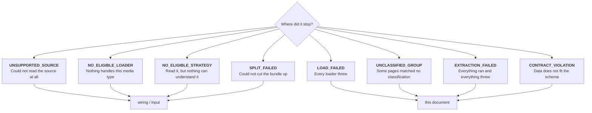
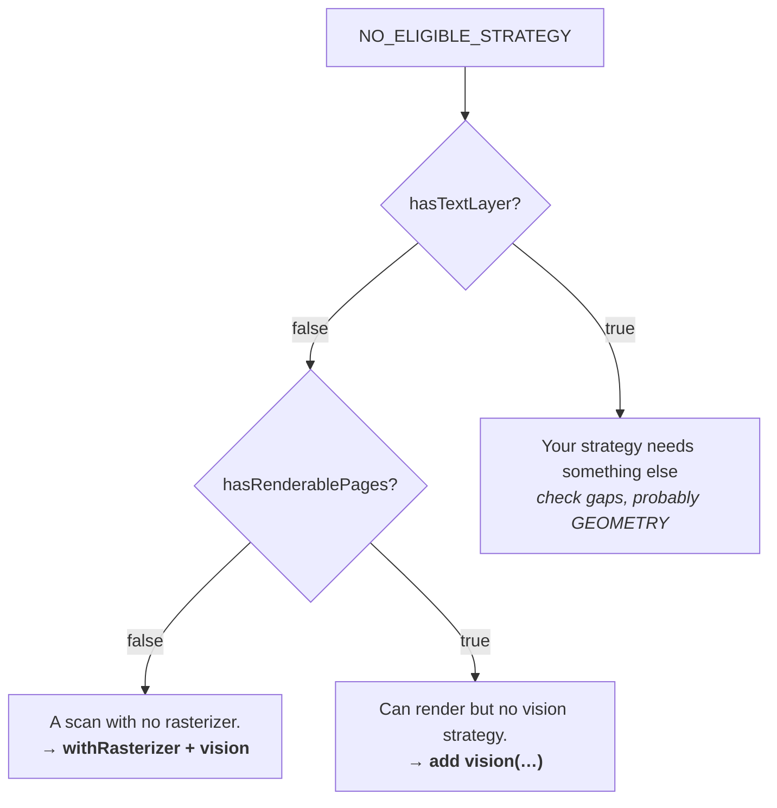
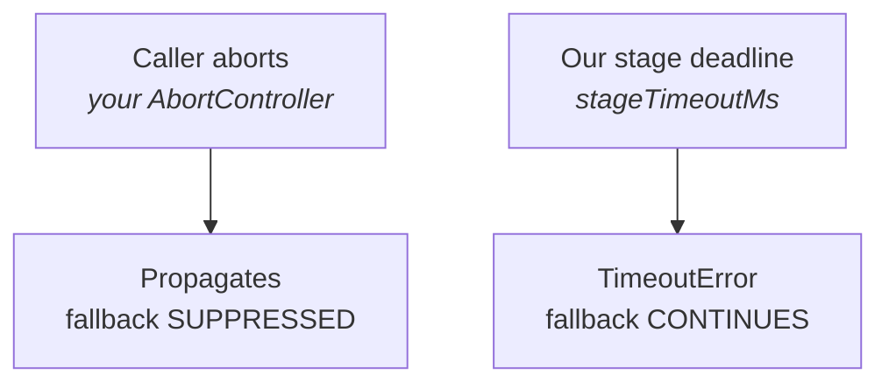

Every error carries a literal `code`, so a `switch` over them is exhaustive.

```ts
import { DoctureError } from "@docture/core";

try {
  await extractor.extract("invoice.pdf", Invoice);
} catch (error) {
  if (error instanceof DoctureError) {
    switch (error.code) {
      case "NO_ELIGIBLE_LOADER":   /* … */ break;
      case "NO_ELIGIBLE_STRATEGY": /* … */ break;
      case "EXTRACTION_FAILED":    /* … */ break;
      // …
    }
  }
}
```

## Which one, and what it means



The **wiring** ones you fix once. The **document** ones you handle per document.

## The catalogue

### `NO_ELIGIBLE_LOADER`

No loader accepts the media type. Almost always a missing loader.

```ts
error.mimeType;  // "application/vnd.openxmlformats-…"
error.gaps;      // [{ name: "pdfjs", reason: 'accepts application/pdf, not "…"' }]
```

### `LOAD_FAILED`

Every eligible loader threw. Corrupt, encrypted, or truncated.

```ts
error.attempts;  // one entry per loader, with its error
```

Encrypted PDFs take a password: `new DocumentLoaderPdfJs({ password: "…" })`.

### `NO_ELIGIBLE_STRATEGY`

The document loaded, but nothing wired can read it. **The most informative error in the
set**, because it carries the document's facts:

```ts
error.features.hasTextLayer;       // false, a scan
error.features.hasRenderablePages; // false, and nothing can render it
error.gaps;                        // [{ name: "llm", reason: "needs TEXT_LAYER" }]
```



### `EXTRACTION_FAILED`

Every eligible strategy ran and threw. `attempts` says why each one did:

```ts
error.attempts;
// [{ strategy: "invoice-parser", status: "failed", error: "no 'Invoice Number:' line" },
//  { strategy: "llm", status: "failed", error: "…", errorCode: "TIMEOUT" }]
```

### `CONTRACT_VIOLATION`

A strategy produced data your schema rejects. Raised when that is the *only* thing that went
wrong, because it is more actionable than "they all threw".

```ts
error.strategy;  // "llm"
error.issues;    // [{ path: "lineItems.2.amount", message: "expected number" }]
```

Usually one of two things: a field that is genuinely absent from some documents should be
`.nullable()`, or the model needs a `.describe()` to know where to look.

### `TIMEOUT`

One of our per-stage deadlines elapsed, set by `stageTimeoutMs`. It is retryable, and the
next strategy still gets a turn.

### `UNSUPPORTED_SOURCE`

An empty file, a protocol that cannot be fetched, or a failed HTTP request.

### `DUPLICATE_COMPONENT`

Two components registered under one name. Thrown at construction, not at run time, so it is
never a silent shadowing.

```ts
strategies: [llm({ model: a, name: "cheap" }), llm({ model: b, name: "careful" })]
```

### `SPLIT_FAILED`

`Process` could not cut the bundle. Either no splitter is loaded, no split was planned, or
the splitter needs something the document does not have.

```ts
error.reason;  // "ImageSplitter needs RENDERABLE_PAGES"
error.gaps;    // [{ name: "ImageSplitter", reason: "document lacks RENDERABLE_PAGES" }]
```

An `ImageSplitter` reads pictures of the pages, so it needs a loader that can render them.
Compose one with `withRasterizer(loader, rasterizer)`.

### `UNCLASSIFIED_GROUP`

A split produced a group whose classification is not in the list you passed.

```ts
error.pages;           // [7, 8]
error.classification;  // "UNKNOWN"
error.candidates;      // ["invoice", "licence"]
```

This is an error rather than a silent skip because pages that fall out of a bundle are
exactly the ones nobody notices are missing. To drop them on purpose, pass
`{ onUnclassified: "skip" }` to `process.extract()`.

## Abort is not a timeout



The distinction is deliberate. You asked it to stop, so trying the next strategy would be
doing work you cancelled. An internal deadline is just that strategy failing.

## Handling without try/catch

```ts
const outcome = await extractor.safeExtract("invoice.pdf", Invoice);

if (outcome.ok) {
  save(outcome.result.data);
} else {
  switch ((outcome.error as DoctureError).code) {
    case "NO_ELIGIBLE_STRATEGY": return queue.push("needs-ocr", file);
    case "CONTRACT_VIOLATION":   return queue.push("needs-review", file);
    default:                     return queue.push("failed", file);
  }
}
```

In a batch, failures arrive as items rather than exceptions, so one bad document does not
lose the rest:

```ts
for await (const item of extractor.extractBatch(files, Invoice)) {
  if (!item.outcome.ok) console.error(files[item.index], item.outcome.error.message);
}
```

## Reading a partial success

A run can succeed while telling you something went wrong on the way:

```ts
result.attempts.filter((a) => a.status === "failed");
```

Worth logging. A deterministic parser that quietly started failing, with a model quietly
picking up the bill, looks like success until you check.
