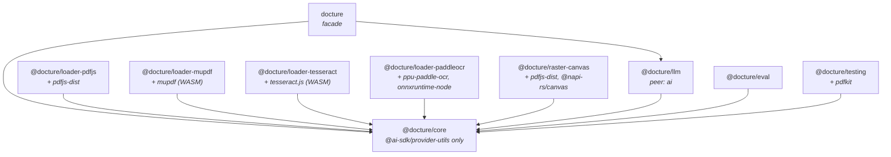
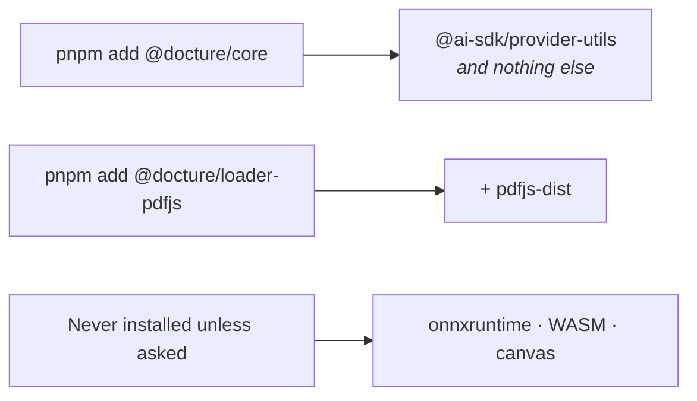
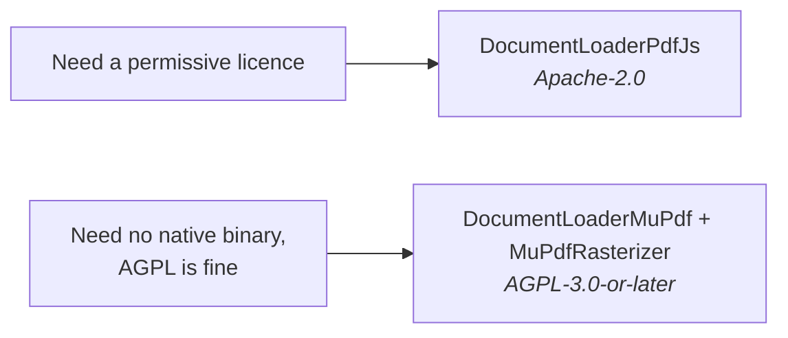
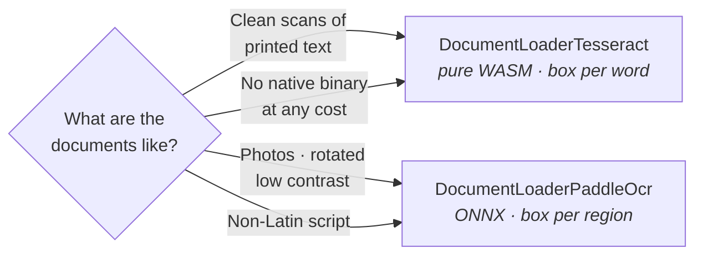

## What ships today

| Package | Install it for |
|---|---|
| `docture` | The usual starting point. Re-exports `core` + `llm` through one import. |
| `@docture/core` | The pipeline on its own: contracts, typed errors, no model. |
| `@docture/loader-pdfjs` | Reading PDFs, with `DocumentLoaderPdfJs` |
| `@docture/loader-mupdf` | Reading **and** rendering PDFs with no native binary, with `DocumentLoaderMuPdf` and `MuPdfRasterizer`. [AGPL](#mupdf-is-agpl-licensed) |
| `@docture/loader-tesseract` | Reading a document with no text layer, with `DocumentLoaderTesseract` (OCR, WASM) |
| `@docture/loader-paddleocr` | The same job, different engine: `DocumentLoaderPaddleOcr` (OCR, ONNX). [Which one?](#paddleocr-or-tesseract) |
| `@docture/raster-canvas` | Rendering pages, with `NapiCanvasRasterizer` |
| `@docture/llm` | Using a model: `LLM`, `LlmStrategy`, `VisionStrategy`, `LlmClassifier`, `TextSplitter`, `ImageSplitter` |
| `@docture/eval` | Measuring accuracy |
| `@docture/testing` | Testing a loader or a consumer |
| `@docture/cli` | Running all of the above from a terminal, as [`docture`](/docs/guides/cli) |



Everything points at `core`, and nothing points sideways. `core` itself depends on one
light package.

## A typical install

```package-install
docture @docture/loader-pdfjs ai @ai-sdk/openai zod
```

Deterministic only, with no model and no API key.

```package-install
@docture/core @docture/loader-pdfjs zod
```

## Why one package per library

So that installing `core` pulls **no PDF library, no WASM, no ONNX, and not even `ai`**.

The alternative, one package with optional extras, leaks. An extra changes what is
importable, and a stray import pulls a dependency you did not ask for. Here it is a package
boundary, and a test walks the import graph to prove nothing heavy is reachable from
`core`:



The libraries are real dependencies of their packages, not optional peers, so
`pnpm add @docture/loader-pdfjs` just works, with no second install and no version drift.

## `ai` is a peer dependency

`@docture/llm` peer-depends on `ai` rather than depending on it, so **your** copy is the one
in play. Two copies would mean the model you construct is typed by a different `ai` than the
one that runs it.

```package-install
@docture/llm ai
```

## MuPDF is AGPL-licensed

`mupdf` is **AGPL-3.0-or-later**. The adapter in `@docture/loader-mupdf` is MIT like the rest of
this project, but installing it pulls MuPDF, and distributing software that links MuPDF puts you
under the AGPL unless you hold a commercial licence from
[Artifex](https://artifex.com/licensing/).

This is one of the reasons loaders are one package per library. Nothing pulls MuPDF unless you
ask for it, and `@docture/loader-pdfjs` (Apache-2.0) is the permissive alternative behind the
same contract. The two pass the same conformance suite, so the swap is an import.



## PaddleOCR or Tesseract

Two OCR packages, same contract, same conformance suite. Swapping is an import, so this is a
choice you can defer and then revisit.



| | `DocumentLoaderPaddleOcr` | `DocumentLoaderTesseract` |
|---|---|---|
| How | two neural nets: detect regions, then recognize | a line recognizer behind a layout analyser |
| Geometry | a box per detected region, so coarser | a box per word |
| Photos, rotation, low contrast | better | poor |
| Non-Latin scripts | a model per script | traineddata per language |
| Runtime | `onnxruntime-node`, a prebuilt native binding | pure WASM |
| First-run download | ~6.5 MB | ~5 MB per language |

Neither is a subset of the other. If the documents matter, run both through
[`@docture/eval`](/docs/guides/measuring-accuracy) and let the score decide. That is what it
is for.

## Planned

Each is a new package plus one `describeLoaderConformance` call. Nothing above it changes.

| Planned | Library |
|---|---|
| `UnpdfLoader` | `unpdf` |
| `MammothLoader`, `ExcelJsLoader`, `CheerioLoader` | `mammoth`, `exceljs`, `cheerio` |
| `AzureDocumentIntelligenceLoader`, `AwsTextractLoader`, … | cloud document AI |
| Splitters | multi-document bundles |

Want one sooner? [Write your own loader](/docs/guides/custom-loader). It is about fifty
lines, and the conformance suite tells you when it is right.

## No native binaries

Every package on this page installs with `pnpm add` and nothing else. No compiler, no system
library, no build step. Two grades of that, worth telling apart:

| | |
|---|---|
| **No platform-specific artifact at all** | MuPDF's WASM build, `tesseract.js`, and everything in `core` |
| **A prebuilt binding, fetched to match your platform** | `@napi-rs/canvas` for rendering, `onnxruntime-node` for `DocumentLoaderPaddleOcr` |

Both install without a toolchain. If you need the stronger guarantee, with nothing
platform-specific anywhere, `DocumentLoaderMuPdf` renders and `DocumentLoaderTesseract` reads OCR entirely
in WASM. The model is whichever AI SDK provider you already use.
